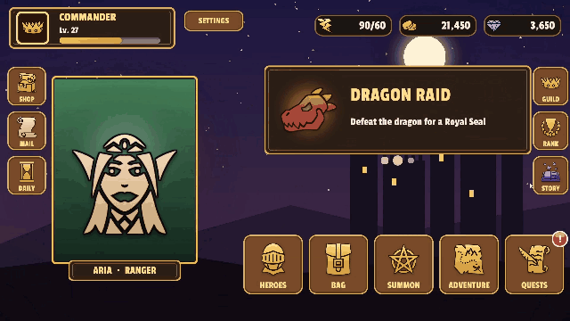

# 코드에서 쓰기 — API

KeyTween의 네임스페이스는 `KeyTweening`이고, 게임 오브젝트에 붙이는 컴포넌트는 `KeyTween`입니다.

연출은 에디터에서 상태(State) 단위로 만듭니다([Guide](Guide.md)). 상태는 이름이 붙은 연출 하나이고, 트랙과 키로 이루어집니다. 코드가 하는 일은 **상태를 이름으로 재생하고, 끝날 때까지 기다리는 것**입니다.

## 재생

`KeyTween` 컴포넌트는 상태를 이름으로 재생하고 제어하는 메서드를 제공합니다.

```csharp
public sealed class KeyTween : MonoBehaviour
{
    public void Play(string stateName);              // 인자가 하나이므로 Button OnClick 같은 UnityEvent 목록에도 나옵니다
    public void Play(string stateName, PointerEventData pointer);   // Start = Pointer 트랙(누른 자리)에 씁니다
    public Awaitable PlayAsync(string stateName, CancellationToken cancellationToken = default);
    public void PlayReversed(string stateName);      // UnityEvent 목록에도 나옵니다
    public Awaitable PlayReversedAsync(string stateName, CancellationToken cancellationToken = default);

    public void Complete(string stateName);         // 재생 중인 상태를 끝으로 건너뜁니다
    public void Stop(string stateName);             // 그 자리에서 멈춥니다
    public void Sample(string stateName, float time);   // 재생하지 않고 그 시간의 모습만 씁니다

    public bool IsPlaying(string stateName);
    public bool HasState(string stateName);
    public float Duration(string stateName);        // 오버라이드를 반영한 길이이며, 없는 상태면 0입니다
}
```

| 메서드 | 동작 |
|---|---|
| `Play` | 재생을 시작합니다. |
| `PlayAsync` | 재생을 시작하고, 끝날 때까지 기다립니다. |
| `PlayReversed` | 끝에서 시작 쪽으로 재생합니다. |
| `Complete` | 재생 중인 상태를 끝 모습으로 건너뜁니다. |
| `Stop` | 그 자리에서 멈춥니다. |
| `Sample` | 재생하지 않고 그 시간의 모습만 씁니다. |

### 상태 재생하기

`Play`는 재생을 시작하고, 첫 모습(0초)을 **바로** 씁니다. 없는 상태 이름을 넘기면 경고 로그만 남깁니다.

```csharp
anim.Play("Open");
```

Start = Pointer 트랙이 있으면 `pointer`를 함께 넘깁니다. 트랙은 이 값으로 누른 자리를 압니다.

```csharp
public void OnPointerDown(PointerEventData eventData) => anim.Play("Press", eventData);
```

### 끝날 때까지 기다리기

`PlayAsync`는 재생이 끝에 닿거나 `Complete`가 호출되면 완료됩니다.

```csharp
await anim.PlayAsync("Open", destroyCancellationToken);
```

* 끝나지 못하면 `OperationCanceledException`으로 끝납니다. 자세한 내용은 [끝나는 경우](#끝나는-경우)를 참고하세요.
* 없는 상태면 바로 완료됩니다.
* Unity `Awaitable`이므로 **한 번만** await할 수 있습니다.
* 반복(Loop) 상태의 `PlayAsync`는 `Complete`나 `Stop`을 부르기 전에는 끝나지 않습니다.

### 역재생하기

`PlayReversed`는 끝에서 시작 쪽으로 재생합니다. 끝날 때까지 기다리려면 `PlayReversedAsync`를 씁니다.

```csharp
await anim.PlayReversedAsync("Open");   // 열기를 시작한 자리로 돌아갑니다
```

* 이벤트, 사운드, 자식 호출도 거꾸로 한 번씩 발생합니다.
* 자식 상태도 역재생됩니다.
* Start = Current Value 트랙은 마지막 정방향 재생이 잡아 둔 값을 다시 씁니다. 그래서 되돌리기 연출이 열기를 시작한 자리로 정확히 돌아갑니다.

### 끝으로 건너뛰기

`Complete`는 재생 중인 상태를 끝 모습으로 이동시키고, `PlayAsync`를 정상 완료합니다. 재생 중일 때만 동작합니다.

```csharp
anim.Complete("Open");
```

* 남은 이벤트와 자식 호출은 순서대로 발생합니다.
* 남은 사운드는 재생하지 않습니다.
* 역재생 중이면 시작 모습으로 이동합니다.

### 멈추기

`Stop`은 상태를 그 자리에서 멈춥니다. 기다리던 `PlayAsync`는 취소됩니다. 반복 상태를 끌 때 씁니다.

```csharp
anim.Stop("Idle");
```

### 특정 시간의 모습 쓰기

`Sample`은 시간을 0부터 상태 길이 사이로 잘라, 그 시간의 모습을 씁니다. 스크롤 위치처럼 시간이 아닌 값으로 모습을 정할 때 씁니다.

```csharp
anim.Sample("Reveal", progress * anim.Duration("Reveal"));   // progress: 0 ~ 1
```

* 타이머, 이벤트, 사운드는 동작하지 않습니다.
* 상태가 재생 중이면 멈춥니다.

### 상태 확인하기

`IsPlaying`, `HasState`, `Duration`으로 상태를 확인합니다. `Duration`은 오버라이드를 반영한 길이이며, 없는 상태면 0입니다.

```csharp
if (anim.HasState("Open") && !anim.IsPlaying("Open")) anim.Play("Open");
```

### 재생 시간

시간은 실시간으로 흐릅니다. `Time.timeScale`의 영향을 받지 않습니다.

### 다른 상태와 겹칠 때

재생 중인 다른 상태가 같은 속성을 움직이고 있으면, 새 상태가 그 속성만 현재 값에서 이어받습니다. 앞 상태를 끝 모습까지 마친 뒤 시작하려면 먼저 `Complete`를 부릅니다.

```csharp
anim.Complete("앞 상태");
anim.Play("다음 상태");
```

자세한 내용은 [Guide §11](Guide.md#11-여러-상태가-겹칠-때)을 참고하세요.

### 끝나는 경우

`PlayAsync`가 어떻게 끝나는지, 그리고 아직 지나지 않은 이벤트와 사운드가 어떻게 처리되는지는 다음과 같습니다.

| 경우 | `PlayAsync` 결과 | 남은 이벤트 | 남은 사운드 |
|---|---|---|---|
| 끝에 도달 | 완료 | 모두 발생 | 모두 재생 |
| `Complete` 호출 | 완료 | 순서대로 발생 | 재생 안 함 |
| 다른 상태가 속성을 모두 가져감 | 취소 | 발생 안 함 | 재생 안 함 |
| 같은 상태를 다시 재생 | 이전 재생 취소 | 발생 안 함 | 재생 안 함 |
| 오브젝트 비활성화 | 취소 | 발생 안 함 | 재생 안 함 |
| `Stop` 호출, 토큰 취소 | 취소 | 발생 안 함 | 재생 안 함 |

끝까지 가지 못한 재생은 **취소**로 끝납니다. 이렇게 하면 "재생이 실제로 끝났을 때만 다음 동작을 한다"는 흐름이 기본이 됩니다.

### 예: 팝업 닫기

닫히는 도중에 팝업이 다시 열리면, 닫기 재생은 취소되고 팝업은 Destroy되지 않습니다.

```csharp
try { await popup.PlayAsync("Close", cancellationToken: popup.destroyCancellationToken); }
catch (OperationCanceledException) { return; }   // Open이 Close의 속성을 가져갔으므로 팝업을 유지합니다
Destroy(popup.gameObject);
```

### 예: 대사창

같은 TMP 텍스트의 내용을 바꿔 가며 같은 상태를 다시 재생합니다. 건너뛰기는 `Complete`로 처리합니다. 재생할 때마다 글자 수를 새로 읽으므로 연출은 새 대사에 맞춰 동작합니다.

```csharp
dialogue.text = nextLine;
var typing = anim.PlayAsync("Typewriter");
// 건너뛰기 버튼: anim.Complete("Typewriter");
await typing;
```

RPG 샘플의 스토리 화면은 이 방식으로 대사를 한 글자씩 보여 줍니다.



## 여러 KeyTween을 함께 기다리기

여러 오브젝트의 `KeyTween`을 동시에 재생하고, 모두 끝날 때까지 기다리는 방법입니다.

### 모두 시작한 뒤 차례로 기다리기

`PlayAsync`는 .NET `Task`가 아니라 Unity `Awaitable`을 돌려주므로 `Task.WhenAll`에 바로 넣을 수 없습니다. 대신 재생은 `PlayAsync`를 부르는 순간 시작됩니다. 전부 먼저 시작해 두고 차례로 기다리면 `WhenAll`과 같은 결과를 얻습니다.

```csharp
var plays = anims.Select(a => a.PlayAsync("Hover")).ToList();   // 여기서 모두 동시에 시작합니다
foreach (var play in plays) await play;                         // 모두 끝날 때까지 기다립니다
```

### Task.WhenAll로 기다리기

`Task.WhenAll`을 쓰려면 각 재생을 `Task`로 감쌉니다.

```csharp
static async Task AsTask(Awaitable awaitable) => await awaitable;

await Task.WhenAll(anims.Select(a => AsTask(a.PlayAsync("Hover"))));
```

### UniTask.WhenAll로 기다리기

UniTask를 설치했다면 [연동](Integrations.md)에서 제공하는 `PlayUniTaskAsync`를 쓸 수 있습니다.

```csharp
await UniTask.WhenAll(anims.Select(a => a.PlayUniTaskAsync("Hover")));
```

### 하나가 취소되면

재생 중 하나라도 취소되면([끝나는 경우](#끝나는-경우)) `OperationCanceledException`이 발생합니다. 예외가 발생하는 위치는 방법마다 다릅니다.

* 차례로 기다리기: 취소된 재생을 기다리는 `await`
* `Task.WhenAll`, `UniTask.WhenAll`: `WhenAll`

## 런타임에 끝 값 바꾸기

재화나 전투력처럼 끝 값이 실행 중에야 정해지는 연출에 씁니다. 시간과 이징 같은 움직임은 에디터에서 만들고, 코드에서는 끝 값만 넘깁니다.

```csharp
public void SetEndValue(string stateName, Component target, KeyTweenProperty property, Vector4 value);
public void SetEndValue(string stateName, Component target, KeyTweenProperty property, float value);   // x만 바꿉니다
```

### 끝 값을 넘기고 재생하기

재생하기 전에 `SetEndValue`를 호출합니다.

```csharp
// 금화 라벨의 "Count" 상태: Number (Count) 트랙, Start = Current Value, 0.6초 OutQuad (에디터에서 만듦)
count.SetEndValue("Count", goldLabel, KeyTweenProperty.TextNumber, gold);
count.Play("Count");
```

### 바뀌는 값

`SetEndValue`는 해당 트랙의 **마지막 키 값**을 바꿉니다.

* 바꾼 값은 다음 재생부터 계속 적용됩니다.
* 저장된 데이터는 바뀌지 않습니다.
* 넘긴 값은 키 값과 똑같이 해석됩니다. 즉 Relative To Rest와 Size Relative 설정이 반영됩니다.
* 맞는 트랙이 없으면 경고 로그를 남깁니다.

## 애니메이션 이벤트

에디터의 이벤트 트랙에 놓은 이벤트를 코드에서 받는 방법입니다. 재생이 이벤트의 시간을 지나면 이벤트가 발생합니다.

### 이벤트 데이터 형식 만들기

struct에 `[KeyTweenEvent]`를 붙이면 에디터의 이벤트 형식 목록에 나옵니다.

```csharp
[KeyTweenEvent("Popup Sound")]
public struct PopupSoundEvent { public string clip; public float volume; }
```

* public 필드는 JSON으로 저장됩니다.
* 오브젝트 참조는 저장할 수 없습니다.
* 형식 목록에는 플레이어 빌드에 포함되는 struct만 나옵니다.

### 모든 이벤트 받기

`event KeyTweenEventHandler EventRaised`는 재생이 이벤트를 지날 때 발생합니다. `Complete`는 건너뛴 이벤트를 순서대로 발생시키고, 취소는 이벤트를 발생시키지 않습니다.

```csharp
anim.EventRaised += (in KeyTweenEventInfo e) => Debug.Log($"{e.State}:{e.Name} @ {e.Time}");
```

### 데이터 형식별로 받기

`AddListener<T>`는 데이터 형식이 `T`인 이벤트만 받습니다. 돌려받은 `IDisposable`의 `Dispose`로 해제합니다.

```csharp
using var sub = anim.AddListener<PopupSoundEvent>((in KeyTweenEventInfo e, in PopupSoundEvent data) => Play(data.clip));
```

### 이벤트 기다리기

`WaitEventAsync`는 어느 상태에서든 그 이름의 이벤트가 다음에 발생하면 완료됩니다. 결과는 `Awaitable<KeyTweenEventInfo>`입니다.

```csharp
var info = await anim.WaitEventAsync("Shown");
```

### 이벤트 정보 읽기

`KeyTweenEventInfo`는 readonly struct이며, `in`으로 전달됩니다. 다음 멤버를 제공합니다.

* `Animation`
* `State`
* `Name`
* `Time`
* `TryGetData<T>(out T)`

### 코드 없이 받기

`KeyTweenEventListener` 컴포넌트로 코드 없이 이벤트를 받을 수 있습니다.

1. **Add Component > KeyTween > Event Listener**를 추가합니다.
2. 이벤트 이름에 UnityEvent를 연결합니다.

이때 이벤트 데이터는 넘어가지 않습니다.

## 실행 중에 상태 추가

상태는 보통 에디터에서 만들지만, 코드로 상태를 추가할 수도 있습니다.

### 코드로 상태 추가하기

`AddState`는 상태를 추가합니다. 같은 이름의 상태가 있으면 바꿉니다.

```csharp
public void AddState(KeyTweenState state);
```

화면 전환 컨테이너가 기본 전환 연출을 넣을 때 이 메서드를 씁니다([Screens](Screens.md)). 일반적인 연출은 에디터에서 만드는 것을 권장합니다.

## 값 읽고 쓰기

트랙이 움직이는 속성 하나를, 재생 없이 코드에서 직접 읽고 쓸 수 있습니다.

### 속성 읽기와 쓰기

`KeyTween.Read`와 `KeyTween.Write`는 정적 메서드입니다.

```csharp
public static Vector4 KeyTween.Read(Component target, KeyTweenProperty property);
public static void KeyTween.Write(Component target, KeyTweenProperty property, Vector4 value);
```

### 값의 해석

값은 트랙과 같은 방식으로 해석됩니다.

* 값이 하나인 속성은 `x`를 씁니다.
* `Rotation`은 −180~180 범위로 읽습니다.
* `TextNumber`는 텍스트의 첫 정수를 읽고, `1,234` 형식으로 씁니다.
* 글자별 속성은 쓸 수 없습니다. 이 속성은 재생 중에 메시에 직접 적용되기 때문입니다.

## 사운드 소스

사운드 트랙의 소리를 어느 AudioSource로 재생할지 정합니다.

### AudioSource 정하기

인스펙터의 **Audio Source**(`KeyTween.audioSource`)로 정합니다.

* 지정하면 그 소스로 재생합니다.
* 비워 두면 숨겨진 공용 2D AudioSource 하나로 재생합니다(`PlayOneShot`).

믹서 그룹이나 3D 사운드가 필요할 때만 지정하면 됩니다. 사운드 트랙마다 소스를 따로 지정할 수도 있습니다.

## 선택 연동

다음 라이브러리를 설치하면 KeyTween에 확장 메서드가 추가됩니다.

| 라이브러리 | 확장 메서드 |
|---|---|
| UniTask | `PlayUniTaskAsync`, `PlayReversedUniTaskAsync`, `WaitEventUniTaskAsync` |
| R3 | `PlayAsObservable`, `EventsAsObservable`, `EventAsObservable` |

라이브러리를 설치하면 연동이 자동으로 켜지며, 따로 설정할 것은 없습니다. 자세한 내용은 [Integrations](Integrations.md)를 참고하세요.

## 그 밖의 컴포넌트

`KeyTween` 외에 패키지가 제공하는 컴포넌트와 해당 문서입니다.

| 컴포넌트 | 문서 |
|---|---|
| `KeyTweenTrigger` (Play On) | 에디터에서 Play On을 고르면 자동으로 붙습니다. [Guide §4](Guide.md#4-play-on--재생-시점) |
| `KeyTweenScrollList`, `KeyTweenPageIndicator`, `KeyTweenScrollScrub`, `KeyTweenPullToRefresh` | [ScrollList](ScrollList.md) |
| `KeyTweenScreen`, `KeyTweenPageContainer`, `KeyTweenModalContainer`, `KeyTweenSheetContainer`, `KeyTweenSharedElement` | [Screens](Screens.md) |
| `KeyTweenEventListener` | [애니메이션 이벤트](#애니메이션-이벤트) |
