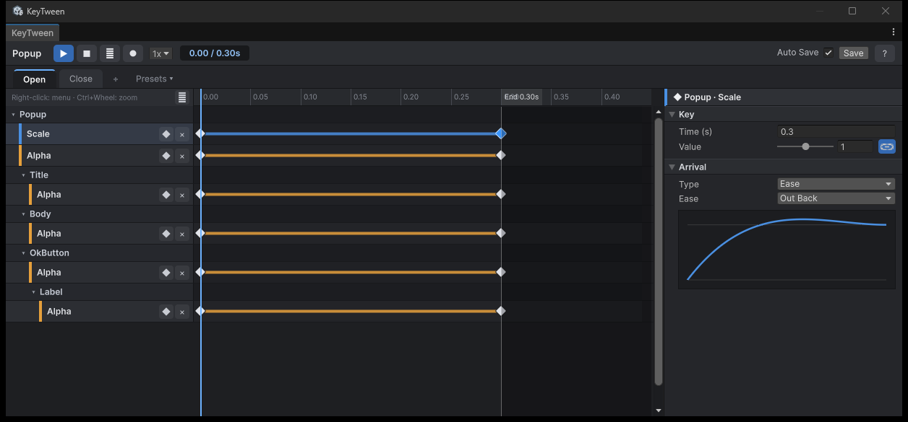

# AI 에이전트로 만들기 — 말로 만들고 에디터에서 고치기

Claude Code, Cursor, Codex 같은 코딩 에이전트에게 연출을 말로 맡길 수 있습니다. 에이전트가 만든 결과는 사람이 만든 것과 같은 상태, 트랙, 키입니다. 그래서 KeyTween 창에서 그대로 열어 키를 끌고, 이징을 바꾸고, 미리 보며 이어서 고칩니다.

KeyTween에는 AI 모델이 들어 있지 않습니다. 에이전트가 애니메이션 데이터를 읽고 쓰는 명령과, 그 형식을 설명하는 계약 문서를 제공합니다. 어떤 에이전트를 쓸지는 사용자가 고릅니다.

## 준비하기

필요한 것은 Unity 6과 Unity CLI 패키지(`com.unity.pipeline`)입니다. Unity CLI가 없어도 KeyTween은 그대로 동작하고, 명령만 빠집니다.

1. **Unity CLI 패키지를 설치합니다.** 프로젝트 폴더에서 `unity pipeline install`을 실행합니다. 설치되면 KeyTween의 명령이 자동으로 컴파일됩니다.
2. **Tools > KeyTween > Set Up Agent Access**를 고릅니다. 프로젝트 폴더의 `AGENTS.md`와 `CLAUDE.md`에 KeyTween 구역이 들어가고, 에이전트는 거기서 명령과 계약 문서를 읽는 방법을 알게 됩니다.
   * 다시 골라도 구역은 하나만 남습니다.
   * 패키지를 업데이트한 뒤에는 한 번 더 골라 계약 문서의 파일 경로를 새로 적습니다. 명령 `keytween_contract`는 업데이트와 상관없이 동작합니다.
3. **Unity 에디터를 연 채로 에이전트에게 요청합니다.**

```text
Assets/UI/Popup.prefab에 열릴 때 살짝 작은 크기에서 커지며 나타나는 Open과,
조금 작아지며 사라지는 Close를 만들어 줘. Close는 Open보다 짧게. 내 코드에서 재생할 거야.
```

MCP 클라이언트에서 쓰려면 `unity mcp configure <클라이언트>`로 Unity CLI를 MCP 서버로 등록합니다. 지원하는 클라이언트는 `unity mcp configure --list`로 봅니다.

## 만들어지는 것

에이전트는 Prefab을 읽고(`keytween_read`), 만든 상태를 써 넣습니다(`keytween_write_prefab`). 아래는 위 요청을 받은 에이전트가 만든 `Open` 상태를 KeyTween 창에서 연 모습입니다. 팝업의 Scale과 각 그래픽의 Alpha 트랙이 들어 있고, 끝 키를 고르면 값과 이징을 바로 바꿀 수 있습니다.



* 상태는 Prefab 안에 저장됩니다. 에디터에서 만든 상태와 구별되지 않습니다.
* 코드에서는 이름으로 재생합니다: `await popup.PlayAsync("Open")`
* 마음에 들지 않는 부분은 KeyTween 창에서 고치거나, 에이전트에게 다시 요청합니다. 에이전트는 다시 읽고 그 위에서 고칩니다.

## 명령

읽기와 두 가지 쓰기가 따로 있어서, 읽기만 허용하거나 씬 수정만 허용할 수 있습니다.

| 명령 | 바꾸는 것 | 설명 |
|---|---|---|
| `keytween_contract` | 없음 | 계약 문서(형식과 규칙)를 설치된 버전 그대로 돌려줍니다. 에이전트가 처음 쓰기 전에 읽습니다. |
| `keytween_read` | 없음 | 대상의 상태(트랙, 키, Play On)와, 움직일 수 있는 오브젝트·트랙 목록을 JSON 문서로 돌려줍니다. 대상을 주지 않으면 열린 씬과 Prefab 모드의 KeyTween 목록을 돌려줍니다. |
| `keytween_write_scene` | 열린 씬의 오브젝트 | 메모리에서만 바꿉니다. 씬은 저장되지 않은 상태로 표시되고, 이 명령은 씬을 저장하지 않습니다. |
| `keytween_write_prefab` | Prefab 애셋 | 그 Prefab의 모든 인스턴스에 적용되고 저장됩니다. Prefab 모드에 열려 있으면 열린 오브젝트를 바꾸고, 저장은 KeyTween 창의 Auto Save 또는 Save를 따릅니다. |

```text
unity command keytween_read --target Assets/UI/Button.prefab
unity command keytween_write_prefab --file Temp/hover.json --dry_run true
unity command keytween_write_prefab --file Temp/hover.json
```

대상은 `KeyTween`이 있는(또는 붙일) 오브젝트입니다. Prefab 애셋은 `Assets/UI/Button.prefab`, 그 안의 오브젝트는 `Assets/UI/Popup.prefab:Panel/OkButton`, 열린 씬의 오브젝트는 `/Canvas/Button`으로 적습니다.

## 안전 장치

사람과 에이전트가 같은 데이터를 고치므로, 서로의 작업을 덮어쓰지 않게 합니다.

* **읽은 뒤에 바뀌었으면 거부합니다.** 읽기는 토큰을 돌려주고, 쓰기는 그 토큰을 함께 보냅니다. 그 사이에 사람이 고쳤거나 다른 쓰기가 있었으면 쓰기를 거부하므로, 에이전트는 다시 읽고 그 문서에서 다시 고칩니다.
* **전부 적용하거나 전혀 적용하지 않습니다.** 없는 경로, 없는 트랙, 개수가 틀린 값, 없는 이징 이름을 한 번에 모두 알려 주고 아무것도 바꾸지 않습니다.
* **Ctrl+Z 한 번으로 되돌립니다.** 컴포넌트 추가와 Play On 설정까지 하나의 Undo 단계입니다.
* **확인만 할 수 있습니다.** `--dry_run true`는 문서를 검사하고 무엇이 바뀔지만 알려 줍니다.
* **Play 모드에서는 쓰지 않습니다.** 열려 있지 않은 씬을 대신 열지도 않습니다.

## 할 수 있는 것과 없는 것

* 쓸 수 있는 것: 상태 만들기·바꾸기·지우기, 반복, Play On, 트랙(내장, Material, 커스텀), 키와 도착 방식, 애니메이션 이벤트
* 그대로 남기는 것: 사운드, 자식 호출, 콜백. 상태를 바꿔 써도 지워지지 않습니다.
* 지원하지 않는 것: 오버라이드, 상태 이름 바꾸기
* 명령은 `KeyTween`과 Play On용 `KeyTweenTrigger` 말고 다른 컴포넌트를 추가하지 않습니다. 팝업 전체를 한 번에 페이드하려면 그 오브젝트에 `CanvasGroup`을 미리 붙여 둡니다.

형식과 규칙은 패키지의 `Editor/Agent/KEYTWEEN-CONTRACT.md`에 있고, `unity command keytween_contract`로도 읽습니다. 필드 이름을 잘못 적으면 그 필드는 무시되고 기본값이 쓰이므로, 에이전트에게는 `--dry_run true`로 먼저 확인하게 하는 편이 안전합니다.

## 다른 경로에서 부르기

명령은 `KeyTweenAgent`의 공개 메서드를 감싼 것입니다. Unity CLI를 쓰지 않는 도구는 에디터 코드에서 직접 부를 수 있습니다.

```csharp
using KeyTweening.Editor;

string contract = KeyTweenAgent.ContractText();
KeyTweenAgentDocument doc = KeyTweenAgent.Read("Assets/UI/Button.prefab");
KeyTweenAgentResult result = KeyTweenAgent.Write(json, KeyTweenAgentScope.Prefab, dryRun: true);
```
