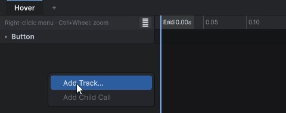
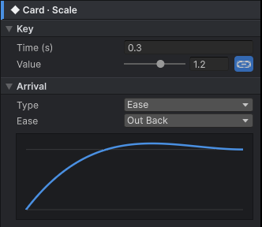
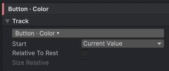

# 사용 설명서 — KeyTween Editor

이 문서는 KeyTween 에디터에서 애니메이션을 만들고, 미리보고, 저장하는 방법을 설명합니다. 에디터 UI는 영문이므로 이 문서도 화면에 보이는 이름을 그대로 적습니다.

## 1. 개념

KeyTween 에디터를 쓰기 전에 알아 두면 좋은 용어를 설명합니다.

### KeyTween 컴포넌트

`KeyTween`은 애니메이션을 담는 컴포넌트입니다. Prefab이나 씬 오브젝트에 붙이면 그 아래에 있는 오브젝트들을 움직입니다.

애니메이션 데이터는 별도의 에셋 없이 `KeyTween` 컴포넌트 안에 직렬화됩니다. 그래서 Prefab을 복제하거나 옮겨도 연출이 함께 따라갑니다.

컴포넌트 인스펙터의 **Time**은 재생 시간이 `Time.timeScale`을 따를지 정합니다. 기본은 `Scaled`(따름)이고, 일시 정지 중에도 움직여야 하는 UI는 `Unscaled`로 둡니다. 자세한 내용은 [재생 시간](API.md#재생-시간)을 참고하세요.

### 상태 (State)

상태는 이름이 붙은 연출 하나입니다. 코드에서도 이 이름으로 재생합니다.

* 예: `Hover`, `Open`, `Close`
* 상태 하나에 트랙이 여러 개 들어갑니다.

자세한 내용은 [상태](#3-상태)를 참고하세요.

### 트랙 (Track)

트랙은 오브젝트 하나의 속성 하나를 움직입니다. 예를 들어 닫기 버튼의 Scale이 트랙 하나입니다.

자세한 내용은 [트랙 추가](#5-트랙-추가)를 참고하세요.

### 키 (Key)

키는 트랙의 한 시점의 값입니다. Unity Animation 창과 마찬가지로, 1 → 1.2 → 1로 움직이면 키가 3개입니다.

자세한 내용은 [키 편집](#6-키-편집)을 참고하세요.

### 도착 방식 (Arrival)

도착 방식은 이전 키에서 이 키로 넘어오는 방식입니다. 다음 중에서 고릅니다.

* 이징 (Ease)
* 커브 (Curve)
* Punch
* Shake

자세한 내용은 [도착 방식](#7-도착-방식)을 참고하세요.

### Play On

Play On은 상태가 저절로 재생되는 시점입니다. 고르지 않으면 코드에서 재생합니다. 고를 수 있는 시점의 예는 다음과 같습니다.

* 포인터가 들어올 때
* 클릭할 때
* 컴포넌트가 켜질 때

자세한 내용은 [Play On](#4-play-on)을 참고하세요.

## 2. 창 열기와 구성

KeyTween 창에서 상태와 트랙을 만들고, 키를 편집하고, 결과를 미리봅니다. 이 페이지는 창을 여는 방법과 화면 구성을 설명합니다.

### 창 열기

다음 중 한 가지 방법으로 창을 엽니다. 창 제목은 "KeyTween"입니다.

* 메뉴에서 **Window > KeyTween Editor**를 고릅니다.
* `KeyTween` 인스펙터에서 **Open KeyTween Editor**를 누릅니다.
* 다른 컴포넌트의 상태 줄에서 **Edit** 또는 **Create**를 누릅니다. [ScrollList](ScrollList.md) 같은 컴포넌트에 이 버튼이 있습니다.

### 편집 대상

창은 선택한 오브젝트나 그 부모에 있는 `KeyTween`을 편집합니다.

인스펙터의 **Raw Data (read-only)** 항목을 펼치면 직렬화된 데이터를 그대로 볼 수 있습니다. 읽기 전용이며, 상태와 트랙은 KeyTween Editor에서 고칩니다.

### KeyTween 붙이기

편집 중인 대상이 없을 때는 창에서 바로 `KeyTween`을 붙일 수 있습니다.

1. RectTransform이 있는 오브젝트를 고릅니다.
2. 창에 나타난 **Add KeyTween to '이름'** 버튼을 누릅니다.

이미 다른 `KeyTween`을 편집하고 있으면 편집 대상이 바뀌지 않습니다. 이때는 **Add Component**로 컴포넌트를 붙입니다.

### 창 구성

창은 상단 바, 상태 탭, 왼쪽의 타임라인, 오른쪽의 인스펙터로 나뉩니다.


| 영역 | 내용 |
|---|---|
| 상단 바 | 대상 이름, 재생과 녹화, 저장 컨트롤 |
| 상태 탭 | 상태마다 탭 하나 |
| 타임라인 (왼쪽) | 오브젝트 계층별로 묶인 트랙 줄, 눈금자, 상태 끝(`End`) 표시 |
| 인스펙터 (오른쪽) | 선택한 항목의 설정 |

* 상태 탭의 툴팁에 그 상태의 Play On이 나옵니다.
* **+** 탭을 누르면 상태가 추가됩니다.
* 인스펙터의 내용은 상태, 트랙, 키, 이벤트, 사운드, 자식 호출 중 무엇을 골랐는지에 따라 바뀝니다.

### 상단 바

상단 바의 컨트롤은 다음과 같습니다.

| 컨트롤 | 기능 |
|---|---|
| **▶** | 재생과 일시정지 |
| **■** | 정지. 원래 값으로 되돌립니다 |
| **⟲** | 반복 |
| **●** | 녹화 |
| 속도 | 0.1x, 0.25x, 0.5x, 1x |
| 시간 | 현재 시간과 길이 |
| **Auto Save**, **Save** | 저장 |
| 주황 점 | 저장되지 않은 값이 화면에 있을 때 표시 |

자세한 내용은 [저장](#14-저장--auto-save--save)과 [녹화](#15-녹화-)를 참고하세요.

## 3. 상태

상태는 이름이 붙은 연출 하나입니다. `Hover`, `Open`, `Close`처럼 상황마다 상태를 만들고, 코드나 Play On으로 그 상태를 재생합니다.

### 상태 추가하기

1. 상태 탭의 **+** 탭을 누릅니다. 이름은 `State`, `State 1`, … 순서로 붙습니다.
2. 새 상태의 탭을 고릅니다.

빈 타임라인과 상태 인스펙터가 나타납니다.


### 상태 인스펙터

트랙이나 키를 선택하지 않았을 때는 인스펙터에 상태의 설정이 나옵니다.

| 항목 | 내용 |
|---|---|
| **Name** | 상태의 이름. 바꾸면 Play On 연결도 새 이름을 따라갑니다 |
| **Loop** | 끝에 닿으면 0초로 이음매 없이 이어서 반복합니다 |
| Duration | 상태의 길이와 트랙 수 (예: `Duration 0.80s · 3 track(s)`) |
| **Play On** | `None` 또는 이벤트 하나 |
| **Delete State** | 확인을 거친 뒤 상태를 삭제합니다 |

* **Loop**는 Animator 클립의 Loop Time과 같은 개념입니다. 이벤트, 사운드, 자식 호출은 바퀴마다 다시 실행됩니다.
* **Play On**에서 이벤트를 고르면 `KeyTweenTrigger` 컴포넌트가 자동으로 붙습니다.

고를 수 있는 이벤트는 [Play On](#4-play-on)을 참고하세요.

### 상태의 길이

상태의 길이는 가장 늦게 끝나는 항목으로 정해집니다. 다음 가운데 가장 늦은 시간이 상태의 길이가 됩니다.

* 트랙의 마지막 키
* 이벤트
* 사운드의 끝
* 자식 호출의 끝

## 4. Play On

Play On은 상태가 코드 없이 저절로 재생되는 시점입니다.

### Play On 고르기

1. 상태 탭을 골라 상태 인스펙터를 엽니다.
2. **Play On** 목록에서 이벤트를 고릅니다.

이벤트를 고르면 `KeyTweenTrigger` 컴포넌트가 자동으로 붙습니다.


### 재생되는 때

| Play On | 재생되는 때 |
|---|---|
| `None` | 자동으로 재생하지 않습니다. 코드에서 `Play`나 `PlayAsync`로 재생합니다 |
| `OnEnable` | 컴포넌트가 켜질 때 |
| `Start` | 처음 켜진 뒤 한 번 |
| `PointerEnter` / `PointerExit` / `PointerDown` / `PointerUp` / `Click` | 해당 포인터 이벤트가 일어날 때 |
| `Select` / `Deselect` | 해당 선택 이벤트가 일어날 때 |
| `ToggleOn` / `ToggleOff` | 같은 오브젝트에 있는 `Toggle`의 값이 바뀔 때 |

코드에서 재생하는 방법은 [API](API.md)를 참고하세요.

### 주의할 점

* 같은 순간에 재생되는 상태가 둘 있으면 경고가 나옵니다. 예를 들어 `OnEnable`과 `Start`는 Instantiate할 때 둘 다 호출됩니다.
* `interactable`이 꺼진 Selectable은 입력 이벤트를 무시합니다. 이때도 `OnEnable`과 `Start`는 재생됩니다.

### UnityEvent에서 재생하기

Button의 OnClick 같은 UnityEvent에서도 상태를 재생할 수 있습니다.

1. 함수 목록에서 `KeyTween.Play (string)`을 고릅니다.
2. 상태 이름을 적습니다.

역재생하려면 `PlayReversed (string)`을 고릅니다.

## 5. 트랙 추가

트랙은 오브젝트 하나의 속성 하나를 움직입니다. 트랙은 트랙 추가 창에서 골라 상태에 넣습니다.

### 트랙 추가 창 열기

타임라인의 빈 곳을 우클릭하고 **Add Track...** 항목을 고릅니다.



### 트랙 고르기

트랙 추가 창의 왼쪽에는 Prefab 안의 오브젝트 트리가 있고, 오른쪽에는 선택한 오브젝트에서 만들 수 있는 트랙 카드가 현재 값과 함께 나옵니다.

1. 왼쪽 트리에서 오브젝트를 고릅니다. 트리는 검색할 수 있습니다.
2. 오른쪽에서 트랙 카드를 클릭해 고릅니다. 여러 개를 고를 수 있습니다.
3. **Add N**을 누릅니다.


* 카드를 더블클릭하면 바로 추가됩니다.
* 다른 오브젝트로 옮겨 가며 골라도 선택은 유지됩니다.
* 이미 있는 트랙에는 `Added` 표시가 붙습니다.

### 새 트랙의 기본값

* 0초 키와 상태 끝 시간의 키가 생깁니다. 두 키 모두 지금 값을 가집니다.
* 상태가 비어 있으면 끝 키는 0.2초에 생깁니다.
* Start는 **Current Value**입니다. 텍스트 트랙만 Key Value로 생깁니다.
* 글자별 트랙의 Stagger는 0.05초입니다.

Start 옵션은 [트랙 옵션](#8-트랙-옵션-트랙-인스펙터)을 참고하세요.

### 만들 수 있는 트랙

트랙 추가 창은 고른 오브젝트에 붙은 컴포넌트에 맞는 트랙만 보여 줍니다.

**오브젝트**

| 대상 | 트랙 |
|---|---|
| 모든 오브젝트 | Scale, Rotation, Active |
| UI가 아닌 오브젝트 (Transform) | Position, World Position, World Rotation |

**UI**

| 대상 | 트랙 |
|---|---|
| RectTransform | Position, Size, Anchor Min, Anchor Max, Pivot, Offset Min, Offset Max |
| CanvasGroup | Group Alpha |
| Graphic (Image, RawImage, TMP 등) | Color, Alpha |
| Image (Image Type = Filled) | Fill Amount |
| RawImage | UV Rect |
| Shadow, Outline | Effect Color, Effect Distance |
| RectMask2D | Softness, Padding |
| Slider | Value |
| ScrollRect | Scroll Position |
| LayoutElement | Min Size, Preferred Size, Flexible Size |

**TextMeshPro**

| 대상 | 트랙 |
|---|---|
| TMP_Text | Font Size, Character Spacing, Word Spacing, Line Spacing, Reveal (Typewriter), Number (Count) |
| TMP_Text 재질 | Outline Width, Outline Color, Face Dilate, Underlay Color |
| TMP_Text 글자별 | Char Scale, Char Position, Char Rotation, Char Color, Char Alpha |

**2D, 3D, 카메라, 소리**

| 대상 | 트랙 |
|---|---|
| SpriteRenderer | Color, Alpha |
| Renderer (MeshRenderer 등) | Material 트랙: 재질의 색, 숫자, 벡터 속성마다 하나 (예: `Material _BaseColor`) |
| Light | Light Color, Intensity, Range (Point, Spot), Spot Angle (Spot) |
| Camera | Camera Background, Camera Size, Field of View, Near Clip, Far Clip, Viewport Rect |
| AudioSource | Volume, Pitch |

**이벤트와 사운드**

| 대상 | 트랙 |
|---|---|
| 루트 | Animation Events, Sound |

**그 밖의 트랙**

* UIEffect를 설치하면 UIEffect 트랙 14종이 추가됩니다. 자세한 내용은 [연동](Integrations.md)을 참고하세요.
* 프로젝트의 컴포넌트를 움직이는 트랙은 직접 만들 수 있습니다. 자세한 내용은 [커스텀 트랙 만들기](API.md#커스텀-트랙-만들기)를 참고하세요.

**알아 둘 점**

* `Group Alpha`는 화면이나 팝업 전체를 페이드할 때 씁니다.
* `Rotation`과 `World Rotation`은 오일러 각(도)입니다. 값을 −180~180 범위로 읽으므로, −30°에서 0°로 갈 때 먼 쪽으로 돌지 않습니다.
* `Active`는 키 사이를 보간하지 않고, 키 시간에 오브젝트를 켜거나 끕니다.
* Material 트랙은 MaterialPropertyBlock으로 씁니다. 재질 에셋은 바뀌지 않고, 같은 재질을 쓰는 다른 오브젝트에도 영향을 주지 않습니다.
* TMP 재질 트랙은 그 텍스트만 쓰는 재질 인스턴스를 만듭니다. 미리보기를 멈추면 원래 재질로 돌아옵니다.

### 트랙 대상 바꾸기

트랙의 대상을 바꾸려면 트랙 인스펙터 맨 위의 `경로 · 속성 ▾` 버튼을 누릅니다.

## 6. 키 편집

키는 트랙의 한 시점의 값입니다. 키는 타임라인에서 추가하고 옮기며, 값과 도착 방식은 키 인스펙터에서 고칩니다.

### 키 선택하고 옮기기

* 키를 클릭하면 선택됩니다.
* Shift나 Ctrl(Mac은 Cmd)을 누른 채 클릭하면 선택에 더해집니다.
* 빈 곳을 드래그하면 박스로 선택합니다.
* 선택한 키를 드래그하면 옮겨집니다.

키는 0.01초 단위로 움직이며, 0초보다 앞으로는 가지 않습니다.

### 키 추가하고 삭제하기

키는 다음 방법으로 추가합니다.

* 줄의 빈 곳을 더블클릭합니다. 그 시간의 보간 값으로 키가 생깁니다.
* 트랙 머리의 **◆** 버튼을 누릅니다. 재생 막대 위치에 키가 생깁니다.
* 우클릭 메뉴에서 **Add Key Here**를 고릅니다.

**모든 트랙은 0초 키를 가집니다.** 0초 키가 없는 트랙에 키를 추가하면 0초 키가 먼저 생깁니다.

키를 삭제하려면 Delete나 Backspace를 누르거나, 우클릭 메뉴에서 **Delete Selected Keys**를 고릅니다.

### 타임라인 보기

| 동작 | 방법 |
|---|---|
| 재생 막대 옮기기 | 눈금자를 클릭하거나 드래그 |
| 확대와 축소 | 눈금자 위에서 휠, 줄 위에서 Ctrl+휠 또는 Alt+휠 |
| 좌우 이동 | Shift+휠, 가로 휠, 휠 버튼 드래그 중 하나 |
| 전체 보기 | `F` 또는 **⤢** |
| 접기 | 오브젝트 줄을 클릭 |

* 확대와 축소는 포인터 위치를 기준으로 합니다.
* 오브젝트 줄을 접으면 그 아래의 키가 작은 다이아몬드로 요약되어 보입니다.
* 눈금자에는 상태가 끝나는 시간(`End 0.80s`)이 표시되고, 그 뒤 구간은 어둡게 칠해집니다.

### 키 인스펙터

키를 고르면 인스펙터에 **Key** 섹션과 **Arrival** 섹션이 차례로 나옵니다. 어떤 키든 구성은 같습니다.



* Key 섹션에서 해당하지 않는 칸은 숨기지 않습니다. 비활성으로 두고 그 이유를 보여 줍니다.
* Arrival 섹션은 고른 Type에 맞는 칸만 보여 줍니다.

### 키 값 정하기

Key 섹션에서 키의 시간(**Time (s)**)과 값을 정합니다. 값 칸의 이름은 값의 뜻에 따라 다음 중 하나로 표시됩니다.

* `Value`
* `Value (rest +)`
* `Value (press point +)`
* `Value (× own size)`
* `Strength` (Punch와 Shake)

값의 종류에 따라 편집 방식이 다릅니다.

* Scale은 하나로 묶인 슬라이더(0~2)로 편집합니다. 버튼을 누르면 축별 편집으로 바뀝니다.
* 색은 색 칸으로 편집합니다.
* Active는 체크 박스로 편집합니다.

재생을 시작할 때 정해지는 값은 비활성입니다. 예를 들어 Start가 Current Value인 트랙의 첫 키가 그렇습니다.

### 지금 값으로 키 정하기

**Capture Current Value**를 누르면 오브젝트의 지금 값이 키에 들어갑니다. 절댓값 트랙에서만 쓸 수 있습니다.

1. Scene에서 오브젝트를 원하는 모습으로 둡니다.
2. 키 인스펙터에서 **Capture Current Value**를 누릅니다.

### 도착 방식 정하기

Arrival 섹션에서 **Type**을 고르고, 그 Type에 맞는 칸을 정합니다. 곡선 그래프도 함께 보입니다.

| Type | 정하는 칸 |
|---|---|
| Ease | Ease |
| Punch, Shake | Ease, Frequency, Damping |
| Curve | Animation Curve |

* 첫 키에는 도착하는 구간이 없으므로 Arrival이 비활성입니다.
* 키를 여러 개 고르면 Arrival을 한꺼번에 바꿀 수 있습니다.

각 Type의 동작은 [도착 방식](#7-도착-방식)을 참고하세요.

## 7. 도착 방식

도착 방식(Arrival)은 이전 키의 값에서 이 키의 값으로 넘어오는 방식입니다. 키 인스펙터의 Arrival 섹션에서 Type을 고릅니다.

### Type

| Type | 동작 |
|---|---|
| `Ease` | 이징 프리셋 중 하나로 움직입니다 |
| `Curve` | AnimationCurve로 움직임을 정합니다 |
| `Punch` | 이전 값을 중심으로 흔들리다가 이전 값으로 돌아옵니다 |
| `Shake` | Punch와 같지만, 축마다 매 프레임 무작위로 흔들립니다 |

### 이징 프리셋

`Ease`에서는 프리셋 36종 중에서 고릅니다.

* Linear
* Sine, Quad, Cubic, Quart, Quint, Expo, Circ, Elastic, Back, Bounce 각각의 In, Out, InOut
* CustomAnimationCurve (Linear과 같음)
* OutBackQuad, OutBackCubic, OutBackQuart, OutBackQuint (Unity-AnimationUI의 OutBack에 해당)

앞의 32종은 LitMotion `Ease`와 번호와 공식이 같습니다.

### Curve

`Curve`는 AnimationCurve의 값으로 움직임을 정합니다.

* 0은 이전 키의 값입니다.
* 1은 이 키의 값입니다.
* 1을 넘으면 목표를 지나쳤다가 돌아옵니다.

### Punch와 Shake

Punch와 Shake에서 키 값은 목적지가 아니라 **세기**입니다. 계산 공식은 LitMotion과 같습니다.

| 칸 | 뜻 |
|---|---|
| `Frequency` | 초당 흔들림 횟수 |
| `Damping` | 흔들림이 줄어드는 정도 |

## 8. 트랙 옵션 (트랙 인스펙터)

트랙 옵션은 첫 키의 값을 어디서 가져올지, 키 값을 무엇을 기준으로 읽을지 정합니다. 트랙을 고르면 트랙 인스펙터에 나옵니다.



### Start

첫 키의 값을 어디서 가져올지 정합니다.

| 값 | 뜻 |
|---|---|
| `Key Value` | 키에 적힌 값 |
| `Current Value` | 재생을 시작하는 순간의 값 |
| `Pointer (press position)` | 상태를 재생시킨 포인터를 누른 위치. Position 트랙에서만 쓸 수 있습니다 |

* `Current Value`는 재생이 중간에 끊겨도 값이 튀지 않습니다. 그래서 호버와 언호버, 열기와 닫기에 씁니다.
* `Current Value` 트랙의 첫 키를 0초보다 뒤에 두면 그 시간만큼 기다렸다가 출발합니다.
* `Pointer`에서는 뒤의 키들이 누른 자리를 기준으로 합니다. 그래서 `(0,0)`이 "누른 그 자리"입니다. 버튼 리플 효과에 씁니다.

### Relative To Rest

키 값을 원래 값에 더합니다. 예를 들어 버튼을 누를 때 크기를 −(34, 17)만큼 바꾸는 데 씁니다.

원래 값은 다음과 같습니다.

* 실행 중: Awake 때의 값
* 미리보기: 미리보기를 시작할 때의 값

### Size Relative

키 값을 대상 자신의 크기에 대한 배수로 읽습니다. x = 1이면 자기 폭만큼입니다. Position과 Size 트랙에서만 쓸 수 있습니다.

그래서 해상도가 달라도 같은 비율로 움직입니다. 예를 들어 화면이 오른쪽으로 한 화면 떨어진 곳(x = 1)에서 0으로 들어오게 할 수 있습니다.

### 텍스트 트랙의 옵션

위 옵션은 키프레임 트랙에 있습니다. 텍스트 트랙은 옵션이 다릅니다.

* Reveal 트랙에는 Scramble만 있습니다.
* 글자별 트랙에는 Stagger와 Duration per Char만 있습니다.
* 텍스트 트랙의 Start는 항상 Key Value입니다.

자세한 내용은 [텍스트 트랙](#9-텍스트-트랙)을 참고하세요.

## 9. 텍스트 트랙

텍스트 트랙은 TMP_Text의 글자를 움직입니다. 글자를 차례로 드러내거나, 숫자를 세거나, 글자마다 따로 움직이게 할 수 있습니다.

### Reveal (Typewriter)

보이는 글자 수를 0~1 비율로 정합니다. 리치 텍스트 태그는 글자 수에 넣지 않습니다.

**Scramble**은 아직 나오지 않은 글자를 무작위 문자로 채웁니다. 원문의 공백은 그대로 두므로 줄바꿈 위치가 튀지 않습니다. 문자 종류는 다음 중에서 고릅니다.

* Uppercase
* Lowercase
* Numerals
* All

### Number (Count)

텍스트 안의 **첫 숫자**만 세어 바꾸고, 나머지 글자는 그대로 둡니다.

* 예: `21/100`, `Lv. 3`
* 정수와 천 단위 쉼표(`1,234`)를 지원합니다.
* Start를 Current Value로 두면 지금 보이는 숫자에서 세기 시작합니다.

끝 숫자를 실행 중에 정하려면 코드에서 `SetEndValue`를 부릅니다. 이때 창에 있는 마지막 키 값은 미리보기용 값이 됩니다. 자세한 내용은 [API](API.md#런타임에-끝-값-바꾸기)를 참고하세요.

### 글자별 트랙

Char Scale, Char Position, Char Rotation, Char Color, Char Alpha가 글자별 트랙입니다. 글자별 트랙의 키는 **글자 하나의 움직임**을 나타냅니다.

| 옵션 | 뜻 |
|---|---|
| **Stagger (s)** | i번째 글자가 i × stagger초 늦게 시작합니다 |
| **Duration per Char (s)** | 0보다 크면 i번째 글자가 자기 키 전체를 i × 이 값(초) 동안 재생합니다 |

타임라인에서 마지막 키 뒤에 이어지는 연한 꼬리가 뒤쪽 글자들이 재생되는 구간입니다. 꼬리 끝을 끌면 Stagger가 바뀝니다.

### 글자별 트랙 합치기

같은 텍스트에 글자별 트랙이 여러 개 있으면 결과가 합쳐집니다.

| 속성 | 합치는 방식 |
|---|---|
| 크기 | 곱합니다 |
| 위치, 회전 | 더합니다 |
| 색, 알파 | 덮어씁니다 |

### 텍스트를 바꾼 뒤 재생하기

텍스트 트랙이 있는 상태는 재생할 때 글자 수를 새로 읽습니다. 그래서 text를 바꾼 뒤 재생하면 길이와 간격이 새 텍스트를 기준으로 정해집니다.

## 10. 이벤트와 사운드

상태의 정해진 시간에 코드에 신호를 보내거나 소리를 낼 수 있습니다. 둘 다 트랙 추가 창에서 트랙으로 추가합니다.

### 이벤트 추가하기

1. 트랙 추가 창에서 `Animation Events`를 고릅니다. 이벤트 트랙이 생깁니다.
2. 트랙 머리의 **+** 버튼을 누르거나 줄을 더블클릭해 이벤트를 추가합니다.
3. 인스펙터에서 **Name**, **Time**, **Type**을 정합니다.

이벤트는 드래그해서 옮깁니다.

### 이벤트 Type

Type은 다음 중 하나입니다.

* `Name Only`
* 코드에서 `[KeyTweenEvent]`를 붙인 struct

struct를 고르면 그 필드를 인스펙터에서 바로 편집할 수 있습니다. 편집할 수 있는 필드 형식은 다음과 같습니다.

* float, int, bool, string
* Vector2/3
* Color
* enum

### 이벤트 받기

이벤트는 다음 두 방법으로 받습니다.

* 코드에서 받습니다. 자세한 내용은 [API](API.md#애니메이션-이벤트)를 참고하세요.
* `KeyTween Event Listener` 컴포넌트로 받습니다. 이 컴포넌트는 이벤트 이름마다 UnityEvent를 연결합니다.

### 사운드 추가하기

1. 트랙 추가 창에서 `Sound`를 고릅니다. 사운드 트랙이 생깁니다.
2. 트랙 머리의 **+** 버튼을 누르거나, 줄을 더블클릭하거나, AudioClip을 줄에 끌어다 놓아 사운드를 추가합니다.
3. 인스펙터에서 **Clip**, **Volume**, **Time**을 정합니다.
4. **▶ Preview**를 눌러 소리를 들어 봅니다.

타임라인의 막대 길이는 클립 길이와 같습니다.

### 소리가 나는 AudioSource

소리는 다음 순서로 찾은 AudioSource에서 재생됩니다. 그래서 UI 오브젝트마다 AudioSource를 붙일 필요가 없습니다.

1. 트랙의 AudioSource
2. `KeyTween`의 Audio Source
3. 둘 다 없으면 숨겨진 공용 2D AudioSource

### 사운드와 상태 길이

상태 길이에는 사운드가 끝나는 시간까지 포함됩니다. 그래서 닫기 연출이 끝난 뒤 오브젝트를 Destroy해도 소리가 끊기지 않습니다.

## 11. 여러 상태가 겹칠 때

여러 상태를 동시에 재생할 수 있습니다. 예를 들어 버튼에 호버하는 중에 버튼을 누르면 두 상태가 함께 재생됩니다.

### 속성 넘겨받기

새 상태는 **자기가 움직이는 속성만** 이전 상태에게서 그 자리에서 넘겨받습니다. 나머지 속성은 이전 상태가 계속 재생합니다.

* 움직일 속성을 모두 넘겨준 상태는 멈추고, 그 상태의 `PlayAsync`는 취소됩니다.
* Start가 Current Value인 트랙은 멈춘 자리에서 이어서 움직입니다. 그래서 호버가 중간에 끊겨도 값이 튀지 않습니다.

### 같은 값을 쓰는 트랙

트랙 종류가 달라도 같은 값을 쓰는 트랙끼리는 **겹치는 부분(채널)만** 넘겨받습니다.

| 같은 값을 쓰는 트랙 | 겹치는 채널 |
|---|---|
| Color와 Alpha (Graphic, SpriteRenderer) | 투명도(a) |
| Char Color와 Char Alpha | 투명도(a) |
| Position, Size와 Offset Min, Offset Max (RectTransform) | Offset이 바꾸는 위치와 크기 |
| Position과 World Position, Rotation과 World Rotation | 전체 |

예를 들어 버튼의 `Hover`가 Color를 재생하는 중에 `Fade`가 Alpha를 재생하면 다음과 같습니다.

* `Hover`는 R, G, B를 계속 씁니다.
* 투명도는 `Fade`가 가져갑니다.
* 반대로 `Fade` 중에 `Hover`가 시작되면, `Fade`는 하나뿐인 채널을 넘겨주었으므로 멈춥니다.

### 앞 상태를 끝내고 넘어가기

앞 상태를 끝 모습까지 맞추고 이벤트도 발생시킨 뒤 넘어가야 할 때가 있습니다. 이때는 코드에서 `Complete("앞 상태")`를 먼저 부르고 다음 상태를 재생합니다.

```csharp
anim.Complete("Hover");   // 앞 상태를 끝 모습으로 맞춥니다
anim.Play("Press");
```

자세한 내용은 [API](API.md#재생)를 참고하세요.

## 12. 자식 호출과 오버라이드 (중첩 Prefab)

버튼 같은 공용 Prefab을 팝업 같은 다른 Prefab 안에 넣었을 때 쓰는 기능입니다.

* **자식 호출**: 팝업의 상태에서 버튼의 상태를 부릅니다.
* **오버라이드**: 버튼의 연출을 팝업 안에서만 바꿉니다.

### 자식 호출 추가하기

자식 호출은 부모 상태의 정해진 시간에 자식 Prefab의 상태를 재생합니다.

1. 오브젝트 줄을 더블클릭하거나, 우클릭한 뒤 **Add Child Call ▸ 자식 ▸ 상태**를 고릅니다.
2. 부모 타임라인에 생긴 막대를 드래그해 시간을 옮깁니다.
3. 인스펙터에서 **Child**, **State**, **Time**을 정합니다.

이미 호출 중인 상태는 체크 표시가 붙고 고를 수 없습니다.

### 자식 호출의 재생

* 부모 상태의 길이에는 `호출 시간 + 자식 상태 길이`가 포함됩니다.
* 부모를 `Complete`하면 자식도 끝 값이 됩니다.
* 부모가 취소되어도 이미 시작한 자식은 계속 재생됩니다.
* 상태끼리 서로 부르는 순환은 깊이 8에서 끊습니다.

### 오버라이드하기

오버라이드는 자식의 연출을 현재 Prefab 안에서만, 트랙 단위로 바꿉니다. 자식 호출 아래에는 자식 상태의 트랙이 호출 시간만큼 밀려서 보입니다. 원본 트랙은 흐리게 보이며 읽기 전용입니다.

1. 자식 호출 아래의 흐린 트랙을 클릭합니다. **그 트랙만** 오버라이드됩니다.
2. 키를 편집합니다. 편집은 오버라이드에 들어가고, 원본 Prefab은 바뀌지 않습니다.

아래 화면에서 Popup Prefab은 안에 든 OkButton Prefab의 Hover 상태에서 Color 키를 노란색으로 오버라이드했습니다. Game 뷰의 버튼은 원본의 빨간색 그대로이고, Scene 뷰와 KeyTween 창에는 팝업의 오버라이드가 보입니다.


### 원본 Prefab을 고쳤을 때

오버라이드는 바깥 Prefab 자신의 `KeyTween`에 저장됩니다. 바꾼 트랙만 저장하므로, 원본에서 다른 트랙을 고치면 그 내용이 팝업에도 반영됩니다.

| 원본 Prefab에서 | 오버라이드한 트랙 | 오버라이드 안 한 트랙 |
|---|---|---|
| 키 값이나 시간 수정 | 팝업의 값이 유지됩니다 | 팝업도 따라 바뀝니다 |
| 트랙 추가 | — | 팝업에도 생깁니다 |
| 트랙 삭제 | 팝업에 남습니다 | 팝업에서도 사라집니다 |

### 여러 단계의 오버라이드

화면 > 팝업 > 버튼처럼 여러 단계가 같은 트랙을 오버라이드하면 **가장 바깥이 이깁니다**. Unity 중첩 Prefab의 규칙과 같습니다.

* 오버라이드된 트랙은 이름이 파란색입니다.
* 툴팁에 어느 Prefab이 덮어썼는지 나옵니다.

### 오버라이드 되돌리기

| 방법 | 되돌리는 범위 |
|---|---|
| 트랙의 **×** | 그 트랙의 오버라이드 가운데 가장 바깥 단계 하나 |
| 자식 호출 제목의 **↺** | 가장 바깥 단계의 오버라이드 전부 (Unity의 Revert All과 같음) |
| **Inspector › Overrides › Revert** | 씬 인스턴스에서 만든 오버라이드 |

## 13. 미리보기

미리보기로 상태가 어떻게 움직이는지 에디터에서 바로 확인합니다. 미리보기는 런타임과 같은 계산을 쓰므로 실제 재생과 결과가 같으며, 자식 호출과 오버라이드도 반영됩니다.

### 미리보기 재생하기

1. 상태 탭에서 미리볼 상태를 고릅니다.
2. 상단 바의 **▶** 버튼을 누릅니다.

특정 시간의 모습을 보려면 눈금자를 끌어 스크럽합니다. 다음은 Play 모드에 들어가지 않고 에디터에서 미리보는 모습입니다.


### 반복, 속도, 사운드

* **반복**: **⟲** 버튼을 켜거나 상태의 Loop를 켜면 반복합니다.
* **속도**: 0.1x~1x 중에서 고릅니다.
* **사운드**: 재생하는 동안 지나간 사운드를 들려줍니다. 스크럽할 때는 소리가 나지 않습니다.

### 미리보는 곳에 따른 동작

| 어디서 | 동작 |
|---|---|
| 씬 (편집 모드) | 바뀌는 속성을 Unity `AnimationMode`에 맡깁니다 |
| Prefab 모드 | 시작할 때의 값을 기억해 두었다가 멈추면 되돌립니다 |
| Project 창에서 고른 Prefab | 그 Prefab을 Prefab 모드로 열고 같은 상태를 미리봅니다 |
| Play 모드 | 실행 중인 오브젝트에 값을 바로 쓰고, 멈추면 되돌립니다 |

* 씬에서는 `AnimationMode` 덕분에 멈추면 원래 값으로 돌아가고, 씬에 저장되지 않습니다.
* Prefab 모드에서 Prefab이 저장될 때(Ctrl+S, Unity Prefab 모드의 자동 저장)는 원래 값을 넣어 저장합니다. 그 뒤 같은 시간의 모습을 다시 보여 줍니다.
* Prefab 원본은 어느 화면에도 그려지지 않습니다. 그래서 Project 창에서 고른 Prefab을 재생하거나 스크럽하면 Prefab 모드로 엽니다.

Play 모드에서도 같은 창으로 미리볼 수 있습니다.


### 시작 모습 자동 결정

어떤 상태는 다른 상태가 끝난 모습에서 시작해야 움직임이 보입니다. 이런 상태는 그 모습에서 시작해 미리봅니다. 짝은 다음과 같습니다.

* Play On 짝: PointerExit←PointerEnter, PointerUp←PointerDown, Deselect←Select, ToggleOff←ToggleOn
* 이름 짝: Open↔Close, Show↔Hide, In↔Out

### 미리보기가 멈추는 때

다음 경우에 미리보기가 멈춥니다.

* **■** 버튼을 누를 때
* 대상이나 상태 탭을 바꿀 때
* 상태를 삭제할 때
* Play 모드에 들어가거나 나올 때
* 스크립트를 다시 불러올 때
* 씬을 저장하거나 닫을 때
* 창을 닫을 때

## 14. 저장 — Auto Save · Save

KeyTween 창에서 고친 내용은 그 `KeyTween`이 있는 곳에 저장됩니다. 어디에 저장되는지는 **Auto Save**와 **Save**의 툴팁에 나옵니다.

### Auto Save와 Save

| 컨트롤 | 동작 |
|---|---|
| **Auto Save** | 자동으로 저장합니다. 기본으로 켜져 있습니다 |
| **Save** | 누를 때 저장합니다 |

* 창에 포커스가 있을 때 Ctrl+S(Mac은 Cmd+S)를 누르면 Save와 같습니다.
* Auto Save는 마지막으로 고친 뒤 0.4초가 지나면 저장합니다. 값을 끄는 동안 매 프레임 저장하지 않기 위해서입니다.
* Auto Save는 Play를 끝낼 때 남아 있는 수정도 저장합니다. Ctrl+Z로 되돌린 내용도 같은 방식으로 저장됩니다.
* Auto Save를 끄면 Save를 눌러야 저장됩니다.

### 저장되는 곳

| 편집하는 것 | 저장되는 곳 |
|---|---|
| Prefab 모드의 오브젝트 | 그 Prefab |
| Project 창에서 고른 Prefab 원본 | 그 Prefab |
| 씬 오브젝트 (편집 모드) | 씬 (Unity의 씬 저장으로 저장) |
| Play 중, 실행 중에 만든 Prefab 복사본 | 원본 Prefab |
| Play 중, 씬에 놓여 있던 오브젝트 | 그 씬 오브젝트 (Play가 끝날 때 반영) |

편집 모드에서 씬 오브젝트를 고치면 두 컨트롤이 꺼지고, 그 이유가 툴팁에 나옵니다. 고친 값은 오브젝트에 바로 들어가며, Unity의 씬 저장(Ctrl+S)으로 저장됩니다.

### Play 중에 저장하기

* 실행 중에 만든 Prefab 복사본은 화면이나 목록 아이템 같은 것입니다. 같은 Prefab에서 나온 다른 실행 중 복사본도 곧바로 같은 값이 됩니다.
* 씬에 놓여 있던 오브젝트의 변경은 Unity가 원래 버립니다. KeyTween은 Play가 끝날 때 그 변경을 씬 오브젝트에 반영하며, 씬 파일은 씬을 저장할 때 써집니다.
* Play 중에 Auto Save를 끈 채 Save하지 않은 수정은 Play가 끝나면 사라집니다.
* Play 중에 중첩 Prefab의 안쪽 부분을 고치면 바깥 Prefab에 오버라이드로 저장되고, 안쪽 Prefab은 그대로입니다.
* 한 번도 저장하지 않은 씬(Untitled)의 오브젝트는 Play가 끝난 뒤 다시 찾을 수 없으므로, 고친 내용이 반영되지 않습니다.

오버라이드는 [자식 호출과 오버라이드](#12-자식-호출과-오버라이드-중첩-prefab)를 참고하세요.

### 주황 점

주황 점은 씬 이름의 `*`처럼, 화면의 값이 저장되지 않은 동안 표시됩니다. 어떤 값인지는 점의 툴팁에 나옵니다.

* 미리보기 중일 때
* 저장하지 않은 수정이 있을 때

## 15. 녹화 (●)

녹화를 켜면 Scene 뷰나 Inspector에서 오브젝트를 바꾸는 것만으로 키를 만들 수 있습니다. Unity Animation 창의 녹화와 같은 방식입니다.

### 녹화하기

1. 상단 바의 **●** 버튼을 켭니다. 버튼이 빨갛게 바뀝니다.
2. 재생 막대를 원하는 시간에 둡니다.
3. Scene 뷰나 Inspector에서 오브젝트를 바꿉니다. 그 값이 키가 됩니다.

오브젝트 자체는 바꾸기 전 값으로 돌아가고, 화면에는 미리보기로 새 키가 반영된 모습이 보입니다. 변경 한 번이 Undo 한 번입니다.

### 녹화로 키가 생기는 방식

| 경우 | 결과 |
|---|---|
| 트랙이 있는 속성 | 재생 막대 위치에 키를 넣습니다. 그 시간에 이미 키가 있으면 값만 바꿉니다 |
| 트랙이 없는 속성 | 트랙을 새로 만들고, 0초 키(바꾸기 전 값)와 재생 막대 위치의 키(바꾼 값)를 넣습니다 |

* Relative To Rest나 Size Relative 트랙에는 그 기준에 맞춘 값을 넣습니다.
* 0초에서 녹화하면 첫 키가 그 값을 쓰도록 Start가 Key Value로 바뀝니다.

### 녹화되는 속성

* Scale, Rotation, Position, Size
* Anchor Min/Max, Pivot
* Active
* Color, Group Alpha, Fill Amount
* Font Size, Character Spacing

Color에서 알파만 바꿨고 Alpha 트랙이 있으면 Alpha로 녹화됩니다.

### 녹화되지 않는 것

* Camera
* Reveal, Number, 글자별 트랙
* UIEffect
* Start가 Pointer인 트랙
* 창에서 편집 중인 `KeyTween` 밖의 오브젝트

### 녹화한 키 저장하기

녹화한 키도 Auto Save와 Save로 저장됩니다. Play 중에도 녹화할 수 있으며, 실행 중 복사본에서 녹화한 키는 원본 Prefab에 남습니다.

## 16. 우클릭 메뉴와 단축키

KeyTween 창에서 쓸 수 있는 우클릭 메뉴와 단축키입니다.

### 우클릭 메뉴

| 어디서 | 메뉴 |
|---|---|
| 타임라인 빈 곳 | Add Track..., Add Child Call ▸ 자식 ▸ 상태 |
| 키프레임 트랙 머리 | Add Key at Playhead, Remove Track (오버라이드 트랙에서는 Revert Track to Original) |
| 키프레임 줄 | Add Key Here, Delete Selected Keys, Remove Track |
| 이벤트, 사운드 트랙 머리 | Add Event / Sound at Playhead, Remove Track |
| 이벤트, 사운드 마커 | Delete |
| 자식 호출 | Revert All (outermost overrides), Remove Child Call |

### 단축키

| 키 | 동작 |
|---|---|
| Ctrl+S (Cmd+S) | Save |
| Delete / Backspace | 고른 키와 마커를 삭제 |
| F | 전체 보기 |
| Esc | 우클릭 메뉴 닫기 |

* 편집 모드의 씬 오브젝트를 편집 중이면 Ctrl+S는 Unity 씬 저장이 됩니다.
* Save 단축키는 **Edit > Shortcuts**의 `KeyTween/Save`에서 바꿀 수 있습니다.

모든 편집은 Unity Undo로 되돌릴 수 있습니다.

## 17. 지원하지 않는 것

현재 KeyTween 에디터가 지원하지 않는 기능입니다.

* 키 복사와 붙여넣기
* 상태 탭에서 바로 이름 바꾸기, 복제하기, 순서 바꾸기. 이름은 상태 인스펙터의 **Name**에서 바꿉니다.

재생 시계는 Design을 참고하세요.
