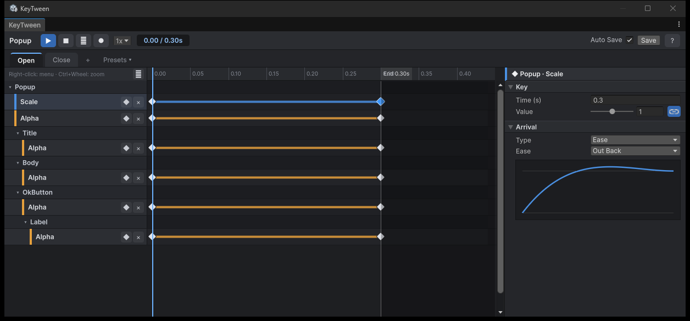

# Creating with AI Agents — Ask in Words, Refine in the Editor

You can hand an animation to a coding agent such as Claude Code, Cursor or Codex in plain words. What the agent makes is the same states, tracks and keys a person makes, so you open it in the KeyTween window and carry on: drag keys, change an ease, preview.

KeyTween contains no AI model. It provides the commands an agent uses to read and write animation data, and a contract document that describes the format. Which agent you use is up to you.

## Setting Up

You need Unity 6 and the Unity CLI package (`com.unity.pipeline`). Without the Unity CLI, KeyTween works as usual; only the commands are missing.

1. **Install the Unity CLI package.** Run `unity pipeline install` in the project folder. Once it is installed, KeyTween's commands compile automatically.
2. **Choose Tools > KeyTween > Set Up Agent Access.** A KeyTween section is added to `AGENTS.md` and `CLAUDE.md` in the project folder, which tells agents the commands and how to read the contract.
   * Choosing it again leaves one section.
   * After updating the package, choose it once more so the contract's file path is written again. The `keytween_contract` command works regardless of updates.
3. **With the Unity Editor open, ask the agent.**

```text
Give Assets/UI/Popup.prefab an Open animation where it grows in from slightly small and fades in,
and a Close where it shrinks a little and fades out. Close shorter than Open. My code will play them.
```

To use it from an MCP client, register the Unity CLI as an MCP server with `unity mcp configure <client>`. `unity mcp configure --list` shows the supported clients.

## What It Makes

The agent reads the prefab (`keytween_read`) and writes the states it made (`keytween_write_prefab`). Below is the `Open` state an agent made from the request above, opened in the KeyTween window. It has the popup's Scale and an Alpha track for each graphic; select the end key to change its value and ease right there.



* The states are stored in the prefab. They are no different from states made in the editor.
* Code plays them by name: `await popup.PlayAsync("Open")`
* Change what you don't like in the KeyTween window, or ask the agent again. The agent reads again and builds on that.

## Commands

Reading and the two writes are separate commands, so you can allow reading only, or scene edits only.

| Command | Changes | Description |
|---|---|---|
| `keytween_contract` | Nothing | Returns the contract (the format and the rules) as installed. An agent reads it before its first write. |
| `keytween_read` | Nothing | Returns the target's states (tracks, keys, Play On) and the objects and tracks that can be animated, as a JSON document. Without a target it lists the KeyTweens of the open scenes and of Prefab Mode. |
| `keytween_write_scene` | An object of an open scene | Changed in memory only. The scene is marked unsaved, and this command never saves it. |
| `keytween_write_prefab` | A prefab asset | Applies to every instance of the prefab and is saved. If the prefab is open in Prefab Mode, the open objects are changed and saving follows the KeyTween window's Auto Save or Save. |

```text
unity command keytween_read --target Assets/UI/Button.prefab
unity command keytween_write_prefab --file Temp/hover.json --dry_run true
unity command keytween_write_prefab --file Temp/hover.json
```

The target is the object that has (or will get) the `KeyTween`. A prefab asset is `Assets/UI/Button.prefab`, an object inside it is `Assets/UI/Popup.prefab:Panel/OkButton`, and an object of an open scene is `/Canvas/Button`.

## Safeguards

People and agents edit the same data, so neither overwrites the other's work.

* **Refused if it changed after the read.** A read returns a token, and a write sends it back. If a person edited the data in between, or another write happened, the write is refused, so the agent reads again and redoes its change on that document.
* **All or nothing.** A missing path, an unknown track, a value with the wrong number of components or an unknown ease name are all reported at once, and nothing is changed.
* **One Ctrl+Z undoes it.** Adding the component and setting Play On are part of the same Undo step.
* **Check only.** `--dry_run true` checks the document and reports what would change.
* **Nothing is written in Play mode.** A scene that is not open is not opened for the agent.

## What It Can and Cannot Do

* Written: creating, replacing and deleting states, loop, Play On, tracks (built-in, Material, custom), keys and their arrival, animation events
* Kept as they are: sounds, child calls, callbacks. Replacing a state does not remove them.
* Not supported: overrides, renaming a state
* The commands add no component other than `KeyTween` and, for Play On, `KeyTweenTrigger`. To fade a whole popup at once, give that object a `CanvasGroup` beforehand.

The format and the rules are in the package's `Editor/Agent/KEYTWEEN-CONTRACT.md`, which `unity command keytween_contract` also prints. A misspelled field name is ignored and its default is used, so it is safer to have the agent check with `--dry_run true` first.

## Calling It from Elsewhere

The commands wrap public methods of `KeyTweenAgent`. A tool that does not use the Unity CLI can call them from editor code.

```csharp
using KeyTweening.Editor;

string contract = KeyTweenAgent.ContractText();
KeyTweenAgentDocument doc = KeyTweenAgent.Read("Assets/UI/Button.prefab");
KeyTweenAgentResult result = KeyTweenAgent.Write(json, KeyTweenAgentScope.Prefab, dryRun: true);
```
