# User Guide — KeyTween Editor

This guide explains how to create, preview and save animations in the KeyTween editor. The editor UI is in English, and this guide uses the names exactly as they appear on screen.

## 1. Concepts

This page explains the terms used throughout the KeyTween editor.

### The KeyTween Component

`KeyTween` is the component that holds the animation. Add it to a prefab or a scene object, and it animates the objects under it.

The animation data is serialized inside the `KeyTween` component, with no separate asset. As a result, the animation travels with the prefab when you duplicate or move it.

**Time** in the component inspector decides whether playback follows `Time.timeScale`. The default is `Scaled` (it follows); set it to `Unscaled` for UI that must keep moving while the game is paused. For details, see [Play Time](API.md#play-time).

### State

A state is one named animation. Code plays a state by this name.

* Examples: `Hover`, `Open`, `Close`
* A state can contain several tracks.

For details, see [States](#3-states).

### Track

A track animates one property of one object. For example, the Scale of a close button is one track.

For details, see [Adding Tracks](#5-adding-tracks).

### Key

A key is the value of a track at one point in time. As in the Unity Animation window, animating 1 → 1.2 → 1 takes three keys.

For details, see [Editing Keys](#6-editing-keys).

### Arrival

Arrival is how the value moves from the previous key to this one. Choose one of the following:

* An ease (Ease)
* A curve (Curve)
* Punch
* Shake

For details, see [Arrival](#7-arrival).

### Play On

Play On is the moment a state plays by itself. If you do not pick one, the state plays from code. Examples of moments you can pick:

* When the pointer enters
* On click
* When the component is enabled

For details, see [Play On](#4-play-on).

## 2. Opening the Window and Its Layout

The KeyTween window is where you create states and tracks, edit keys and preview the result. This page explains how to open the window and what is on screen.

### Opening the Window

Open the window in any of these ways. The window title is "KeyTween".

* Choose **Window > KeyTween Editor** from the menu.
* Click **Open KeyTween Editor** in the `KeyTween` inspector.
* Click **Edit** or **Create** on a state row of another component. Components such as [ScrollList](ScrollList.md) show these buttons.

### The Edited Target

The window edits the `KeyTween` on the selected object or on one of its parents.

Expand **Raw Data (read-only)** in the inspector to see the serialized data as it is stored. It is read-only; edit states and tracks in the KeyTween Editor.

### Adding a KeyTween

When nothing is being edited, you can add a `KeyTween` right from the window.

1. Select an object in the Hierarchy. It does not have to be a UI object (a SpriteRenderer, a 3D object and so on).
2. Click the **Add KeyTween to 'name'** button that appears in the window.

If another `KeyTween` is already being edited, the window keeps that target. In that case, add the component with **Add Component** instead.

### Window Layout

The window is divided into the top bar, the state tabs, the timeline on the left and the inspector on the right.


| Area | Contents |
|---|---|
| Top bar | The target name, playback and recording, and saving controls |
| State tabs | One tab per state |
| Timeline (left) | Track rows grouped by object hierarchy, the ruler and the state end (`End`) mark |
| Inspector (right) | Settings for the selected item |

* A state tab's tooltip shows that state's Play On.
* The **+** tab adds a state.
* The inspector's contents change depending on whether you selected a state, track, key, event, sound or child call.

### The Top Bar

The top bar has the following controls.

| Control | Function |
|---|---|
| **▶** | Play and pause |
| **■** | Stop. Returns to the original values |
| **⟲** | Loop |
| **●** | Record |
| Speed | 0.1x, 0.25x, 0.5x, 1x |
| Time | The current time and length |
| **Auto Save**, **Save** | Saving |
| Orange dot | Shown when unsaved values are on screen |

For details, see [Saving](#14-saving--auto-save--save) and [Recording](#15-recording-).

## 3. States

A state is one named animation. You create a state for each situation, such as `Hover`, `Open` or `Close`, and play it from code or through Play On.

### Adding a State

1. Click **+** in the state tabs. States are named `State`, `State 1`, and so on.
2. Select the new state's tab.

The timeline is empty and the state inspector appears.

### Working with State Tabs

| To | Do this |
|---|---|
| Rename | Double-click the tab, type the new name and press Enter. Esc cancels |
| Duplicate | Right-click the tab › **Duplicate**. The copy appears right after it as `Name Copy` and opens |
| Reorder | Drag the tab sideways and drop it. Right-click › **Move Left** / **Move Right** also works |
| Delete | Right-click the tab › **Delete** (after you confirm) |

* You can also rename with right-click › **Rename** or **Name** in the state inspector. Play On links follow a new name.
* An empty name, or a name another state already uses, is not accepted, because code and Play On find states by name.
* A duplicated state does not get a copy of Play On: one event plays one state.


### State Inspector

When no track or key is selected, the inspector shows the state's settings.

| Item | Contents |
|---|---|
| **Name** | The state's name. Play On links follow a new name |
| **Loop** | When playback reaches the end, it continues seamlessly from 0 s and repeats |
| Duration | The state's length and track count (for example, `Duration 0.80s · 3 track(s)`) |
| **Play On** | `None` or an event |
| **Callbacks** | Functions to call when a play starts (**On Start**), reaches its end (**On Complete**), or does not reach its end (**On Cancel**) |
| **Delete State** | Deletes the state after you confirm |

* **Loop** is the same idea as Loop Time on an Animator clip. Events, sounds and child calls fire again on every loop.
* Choosing an event in **Play On** adds a `KeyTweenTrigger` component automatically.

For the available events, see [Play On](#4-play-on).

### Calling Functions at the Start and End (Callbacks)

In **Callbacks** in the state settings, connect functions to call when a play starts and ends. It works like a Button's **OnClick**: drag in an object and choose a function. Each state has its own.

| Field | When it is called |
|---|---|
| **On Start** | When a play starts (any play method: `Play`, `PlayAsync`, `PlayReversed`, `With(...).Play` and so on). After the first pose, before the animation events at the start time |
| **On Complete** | When the play reaches its end, or `Complete` skips there. After the animation events at the end, before `PlayAsync` completes |
| **On Cancel** | When the play does not reach its end: `Stop`, another state took everything it animates, the object was disabled, the same state was played again, or the `PlayAsync` token was canceled |

* Each play starts with On Start and ends with **exactly one of On Complete and On Cancel**.
* A looping state calls On Start once at the beginning, and On Complete only when you call `Complete`.
* `Stop(state, time)`, which writes a pose without playing, calls no callbacks. Stopping a playing state with it calls On Cancel.
* The preview in this window does not call callbacks, so that no game code runs while you preview.
* Callbacks are saved in the prefab, and a prefab instance can override them like any other Unity value.
* In code, the `StateStarted`, `StateCompleted` and `StateCanceled` events report every state in one place. For details, see [API](API.md#start-and-end-callbacks).

### State Length

A state's length is set by whatever ends last. The latest of the following is the state's length:

* The last key of a track
* An event
* The end of a sound
* The end of a child call

## 4. Play On

Play On sets when a state plays by itself, without code.

### Choosing Play On

1. Select the state tab to show the state inspector.
2. Choose an event from the **Play On** list.

Choosing an event adds a `KeyTweenTrigger` component automatically.


### When Each Option Plays

| Play On | Plays when |
|---|---|
| `None` | The state does not play by itself. Play it from code with `Play` or `PlayAsync` |
| `OnEnable` | The component is enabled |
| `Start` | Once, after the component is first enabled |
| `PointerEnter` / `PointerExit` / `PointerDown` / `PointerUp` / `Click` | The matching pointer event occurs |
| `Select` / `Deselect` | The matching selection event occurs |
| `ToggleOn` / `ToggleOff` | The value of the `Toggle` on the same object changes |

For playing from code, see [API](API.md).

### Example: A Hover Button

A button that grows when the mouse is over it and shrinks back when it leaves takes two states.

1. A `Hover` state: a Scale track from 1 to 1.08, with Play On set to `PointerEnter`.
2. An `Unhover` state: a Scale track from 1.08 to 1, with Play On set to `PointerExit`.
3. Set Start to **Current Value** on both tracks, so that if the mouse leaves while the button is still growing, it shrinks back from where it is.

No code is needed. When the moment depends on the game (the score changed, a screen opened), leave Play On at `None` and play the state from code.

### Things to Note

* A warning appears when two states would play at the same moment. For example, `OnEnable` and `Start` are both called on Instantiate.
* A Selectable whose `interactable` is off ignores input events. `OnEnable` and `Start` still play in that case.
* Pointer events come from the EventSystem. For an object that is not UI (a SpriteRenderer, a 3D object) to get them, the camera needs a `Physics2DRaycaster` or `PhysicsRaycaster` and the object a Collider.

### Playing from a UnityEvent

You can also play a state from a UnityEvent, such as a Button's OnClick.

1. Choose `KeyTween.Play (string)` in the function list.
2. Enter the state name.

To play it in reverse, choose `PlayReversed (string)`.

## 5. Adding Tracks

A track animates one property of one object. You choose tracks in the Add Track window and add them to the state.

### Opening the Add Track Window

Right-click an empty part of the timeline and choose **Add Track...**.


### Choosing Tracks

The left side of the Add Track window shows the object tree of the prefab. The right side shows the track cards available for the selected object, along with their current values.

1. Select an object in the tree on the left. You can search the tree.
2. Click track cards on the right to select them. You can select several.
3. Click **Add N**.


* Double-click a card to add it immediately.
* Your selection is kept while you move between objects.
* Tracks that already exist are marked `Added`.

### Defaults for New Tracks

* A new track gets a key at 0 s and a key at the state's end time. Both keys hold the current value.
* If the state is empty, the end key is placed at 0.2 s.
* Start is **Current Value**. Only Reveal and per-character tracks start with Key Value.
* The end key arrives with the Ease `OutSine`.
* A new per-character track's Stagger is 0.05 s.

For the Start option, see [Track Options](#8-track-options-track-inspector).

### Available Tracks

The Add Track window shows only the tracks that match the components on the selected object.

**Objects**

| Target | Tracks |
|---|---|
| Any object | Scale, Rotation, Active |
| Objects that are not UI (Transform) | Position, World Position, World Rotation |

**UI**

| Target | Tracks |
|---|---|
| RectTransform | Position, Size, Anchor Min, Anchor Max, Pivot, Offset Min, Offset Max |
| CanvasGroup | Group Alpha |
| Graphic (Image, RawImage, TMP, and so on) | Color, Alpha |
| Image (Image Type = Filled) | Fill Amount |
| RawImage | UV Rect |
| Shadow, Outline | Effect Color, Effect Distance |
| RectMask2D | Softness, Padding |
| Slider | Value |
| ScrollRect | Scroll Position |
| LayoutElement | Min Size, Preferred Size, Flexible Size |

**TextMeshPro**

| Target | Tracks |
|---|---|
| TMP_Text | Font Size, Character Spacing, Word Spacing, Line Spacing, Reveal (Typewriter), Number (Count) |
| TMP_Text material | Outline Width, Outline Color, Face Dilate, Underlay Color |
| TMP_Text per character | Char Scale, Char Position, Char Rotation, Char Color, Char Alpha |

**2D, 3D, camera and sound**

| Target | Tracks |
|---|---|
| SpriteRenderer | Color, Alpha |
| Renderer (MeshRenderer and so on) | Material tracks: one per color, number and vector property of its material (e.g. `Material _BaseColor`) |
| Light | Light Color, Intensity, Range (Point, Spot), Spot Angle (Spot) |
| Camera | Camera Background, Camera Size, Field of View, Near Clip, Far Clip, Viewport Rect |
| AudioSource | Volume, Pitch |

**Events and sounds**

| Target | Tracks |
|---|---|
| Root | Animation Events, Sound |

**Other tracks**

* With UIEffect installed, 14 UIEffect tracks are added. For details, see [Integrations](Integrations.md).
* You can write your own track for a component of your project. For details, see [Custom Tracks](API.md#custom-tracks).

**Things to know**

* `Group Alpha` is for fading a whole screen or popup.
* `Rotation` and `World Rotation` use Euler angles in degrees. Values are read in the range −180 to 180, so going from −30° to 0° does not turn the long way around.
* `Active` does not interpolate between keys. It turns the object on or off at each key's time.
* Material tracks write through a MaterialPropertyBlock. The material asset does not change, and other objects that use the same material are not affected.
* TMP material tracks make a material instance used only by that text. When the preview stops, the original material comes back.

### Changing a Track's Target

To change a track's target, click the `path · property ▾` button at the top of the track inspector.

## 6. Editing Keys

A key is the value of a track at one point in time. You add and move keys on the timeline, and edit their values and arrival in the key inspector.

### Selecting and Moving Keys

* Click a key to select it.
* Shift-click or Ctrl-click (Cmd-click on Mac) to add to the selection.
* Drag on empty space in the key area to select the keys the box touches, across tracks. You can start on a track's lane, on the event and child call lanes at the top, or in the empty space below the last track. Hold Shift or Ctrl while dragging to add to the selection.
* Drag one of the selected keys to move all of them by the same time. One Ctrl+Z undoes it.
* When two or more keys at different times are selected, a box spans them. Drag its right handle to stretch or shrink the keys around the left end, or its left handle to do it around the right end; the spacing between the keys scales evenly. A handle stops before the other end, so the keys keep their order. One Ctrl+Z undoes it.

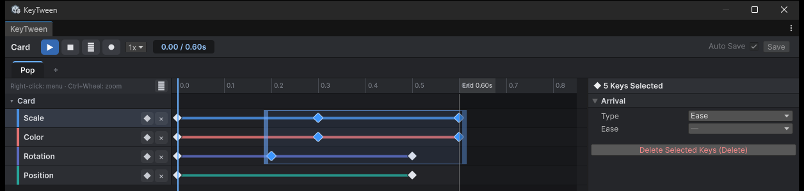

Keys move in 0.01 s steps and never go below 0 s.

### Adding and Deleting Keys

Add a key in any of these ways:

* Double-click an empty part of a row. The key gets the interpolated value at that time.
* Click **◆** on the track header. The key is added at the playhead.
* Right-click and choose **Add Key Here**.

**Every track has a key at 0 s.** If you add a key to a track that has no 0 s key, the 0 s key is created first.

To delete keys, press Delete or Backspace, or right-click and choose **Delete Selected Keys**.

### Copying and Pasting Keys

1. Select keys and press Ctrl+C (Cmd+C on Mac). They can be on several tracks.
2. Put the playhead where the keys should go.
3. Press Ctrl+V (Cmd+V on Mac). **Copy Selected Keys** and **Paste Keys at Playhead** in the context menu do the same.

* The earliest key lands on the playhead and the spacing between the keys stays the same. Values, arrival and curves are copied too.
* Keys go on the track of the same object and kind as the copied ones. Pasted into another state without that track, the track is created.
* Pasted into the KeyTween of another prefab, keys go on the object at the same path from the root. Keys whose object is not there are skipped.
* The playhead does not go past the end of the state. To paste after the end, right-click there and choose **Paste Keys Here**.
* A key already at a pasted time is replaced. The pasted keys are selected, so you can drag them right away.

### Navigating the Timeline

| Action | How |
|---|---|
| Move the playhead | Click or drag on the ruler |
| Zoom | The wheel over the ruler, or Ctrl+wheel or Alt+wheel over the rows |
| Pan | Shift+wheel, a horizontal wheel, or a middle-button drag |
| Frame all | `F` or **⤢** |
| Collapse | Click an object row |

* Zooming is centered on the pointer.
* When an object row is collapsed, the keys under it are summarized as small diamonds.
* The ruler shows where the state ends (`End 0.80s`), and everything after that point is shaded dark.

### Key Inspector

When you select a key, the inspector shows a **Key** section followed by an **Arrival** section. Every key uses the same layout.


* In the Key section, fields that do not apply are not hidden. They are disabled and show the reason.
* The Arrival section shows only the fields for the chosen Type.

### Setting a Key's Value

In the Key section, set the key's **Time (s)** and value. The value field is labeled by what the value means, as one of the following:

* `Value`
* `Value (rest +)`
* `Value (press point +)`
* `Value (× own size)`
* `Strength` (for Punch and Shake)

How you edit the value depends on its kind:

* Scale is edited with one linked slider (0 to 2, or −1 to 1 on a Relative To Rest track). A button switches to per-axis editing.
* Colors use a color field.
* Active uses a checkbox.

Values that are decided when playback starts are disabled. For example, the first key of a track whose Start is Current Value is disabled.

### Setting the Arrival

In the Arrival section, choose a **Type** and set the fields for that Type. A curve graph is shown as well.

| Type | Fields |
|---|---|
| Ease | Ease |
| Punch, Shake | Ease, Frequency, Damping |
| Curve | Animation Curve |

* Arrival is disabled on the first key, since no segment arrives at it.
* With several keys selected, you can change Arrival for all of them at once.

For how each Type behaves, see [Arrival](#7-arrival).

## 7. Arrival

A key sets only **when** (its time) and **what value**. How the track gets **from one key to the next** is its arrival. When you open a drawer, you pull it fast at first and slow down as it comes out: moving the same distance in the same time feels completely different depending on how the speed changes on the way.

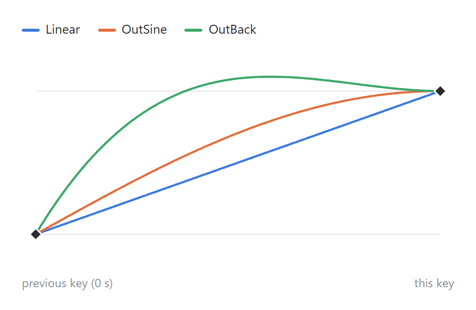

The three lines in the graph have the same keys: 0 at 0 s and 1 at the end. Only the arrival differs.

### One per Key, for the Segment Coming In

Each key has one arrival, and it sets how the track moves **from the previous key to this key**. With three keys there are two segments, and each can use a different arrival.

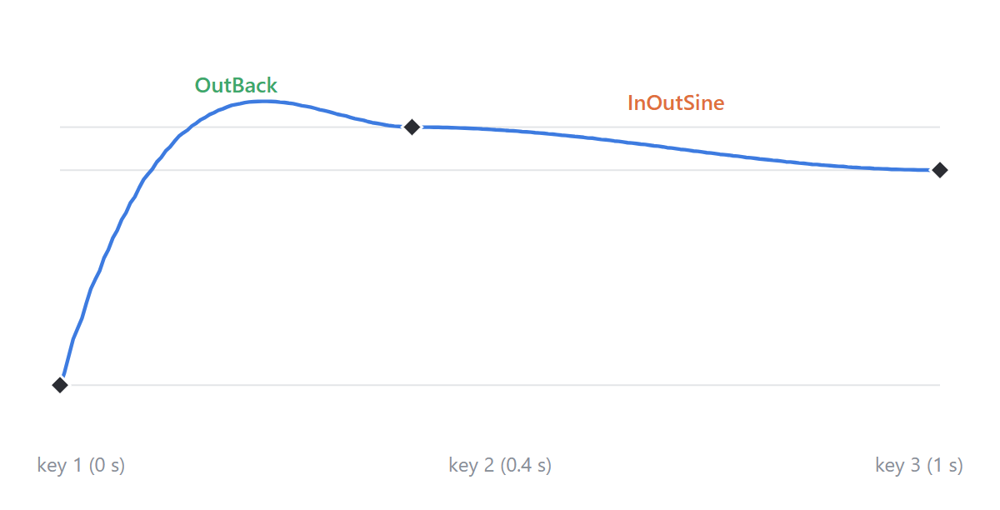

* The segment from key 1 to key 2 uses **key 2's** arrival, and the one from key 2 to key 3 uses **key 3's**.
* The first key has no segment coming in, so its arrival is disabled. The exception is a track whose Start is Current Value with only one key: the segment from the value at play time to that key uses that key's arrival.

### Choosing It in the Editor

1. Select a key on the timeline.
2. In the key inspector's **Arrival** section, choose a **Type**.
3. Set the fields for that Type. The graph below updates at once, showing how the track goes from the previous key's value (lower line) to this key's value (upper line).

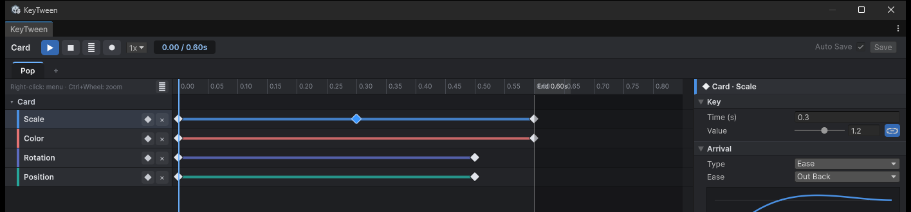

| Type | Fields | Use it for |
|---|---|---|
| **Ease** | Ease (36 curves) | Most animations: pick a ready-made curve |
| **Curve** | Animation Curve | A shape no ease has: draw it yourself |
| **Punch** | Ease, Frequency, Damping | A bump that springs back into place |
| **Shake** | Ease, Frequency, Damping | A random jitter that settles back into place |

* With several keys selected, only the Arrival section is shown, and it changes all of them at once. A field whose value differs between the keys shows `—`.
* Check the result right away with the **▶** preview.

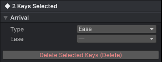

### Ease: Picking a Ready-Made Curve

The most used Type. Choose one of 36 curves. The two parts of a name mean:

| Part | Meaning |
|---|---|
| **In** / **Out** / **InOut** | Where it is slow. In starts slowly and speeds up. Out starts fast and arrives slowly. InOut is slow at both ends |
| **Sine** → Quad → Cubic → Quart → Quint → **Expo** | How strong the change is. Further right, the gap between the slow and fast parts grows |
| **Circ** | A circular arc |
| **Back** | Goes slightly back before starting (In), or slightly past the target before coming back (Out) |
| **Elastic** | Wobbles like a rubber band |
| **Bounce** | Arrives as if bouncing off the floor |

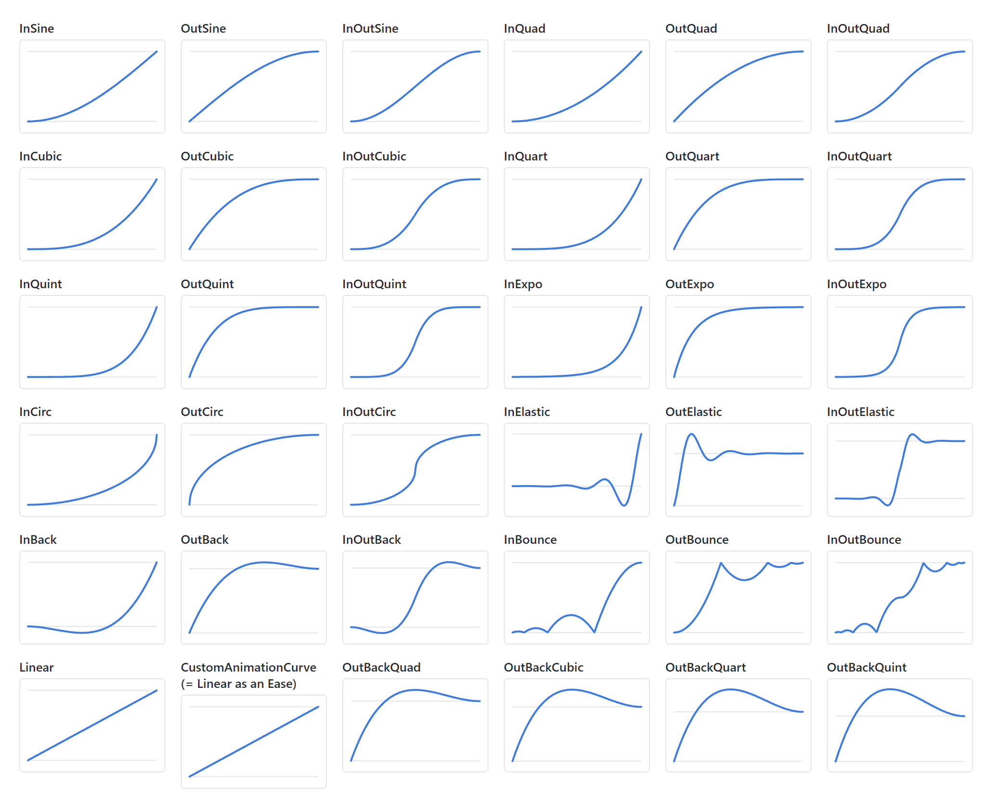

* The first 32, Linear through InOutBounce, match LitMotion's `Ease` in number and formula.
* OutBackQuad through OutBackQuint are Unity-AnimationUI's OutBack family. Each goes further past the target before coming back.
* CustomAnimationCurve as an Ease is the same as Linear. To draw a curve yourself, choose the **Curve** Type.

#### Choosing an Ease for UI

There is no single right answer, but starting from these usually looks natural.

| Animation | Try first | Why |
|---|---|---|
| Entering the screen, opening a popup | OutCubic, OutQuart | Appears quickly and settles softly, so it feels responsive |
| Leaving the screen, closing | InCubic, InQuad | Starts slowly and disappears fast, so the exit does not linger |
| From one place to another (tab switch, slide) | InOutSine, InOutCubic | Soft at both the start and the end |
| A button press, a popup that pops out | OutBack | Goes slightly past and comes back, so it feels springy |
| Falling and landing | OutBounce | Shows the bounce off the floor |
| Counting a number, a progress bar | Linear, OutQuad | A constant speed, or slowing slightly only at the end |
| Repeating breathing or pulsing (Loop) | InOutSine | The speed is 0 at both ends, so the laps join without a break |

### Curve: Drawing Your Own

If no ease has the shape you want, choose the **Curve** Type, click the **Animation Curve** field and draw it in Unity's curve editor.

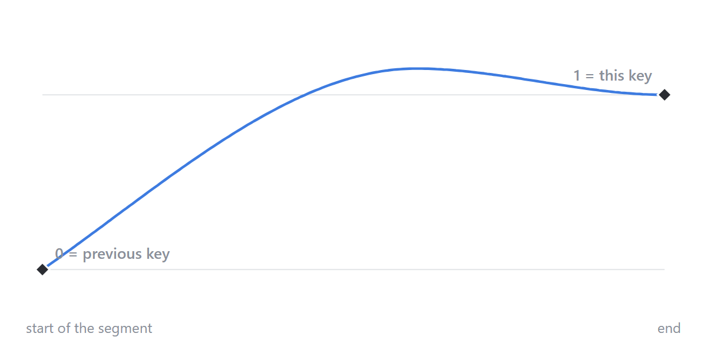

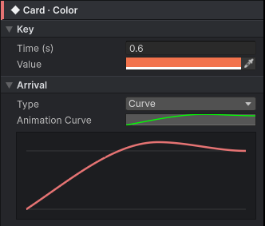

* The horizontal axis is the progress through the segment: 0 at the previous key's time, 1 at this key's time.
* The vertical axis is the value: 0 at the previous key's value, 1 at this key's value. Above 1 or below 0, the track goes past the target or the other way and comes back.
* Usually put the end point at (1, 1), so the track reaches this key's value exactly at this key's time.

### Punch and Shake: Shaking and Settling Back

Use these for a bump when a button is pressed, or a jitter on an error. Unlike the other Types, **this key's value is not a destination but the strength of the shake**. The value shakes around the previous key's value and, when the segment ends, **comes back to the previous key's value**.

* **Punch** goes back and forth at a steady beat.
* **Shake** jitters randomly on each axis every frame.

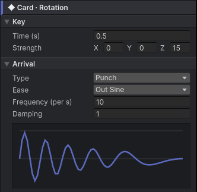

| Field | Meaning | New key |
|---|---|---|
| **Strength** (the key's value) | How big the shake is, per axis. The example above shakes up to 15 degrees on Z | — |
| **Frequency** | How fast it shakes. Higher shakes more often. The same value as LitMotion's frequency | 10 |
| **Damping** | How much the shake dies out. 1 dies out toward the end; 0 keeps the same strength until it returns into place | 1 |
| **Ease** | How the shake is spread over time. With Out Sine, the shakes crowd toward the start and slow down later | Out Sine |

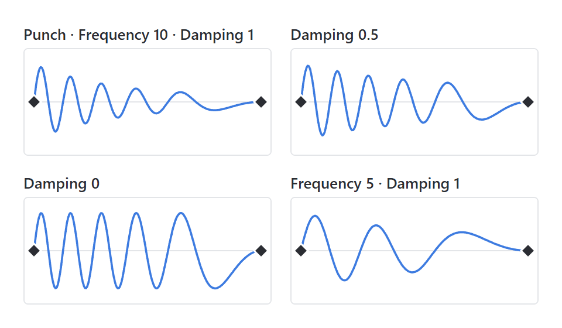

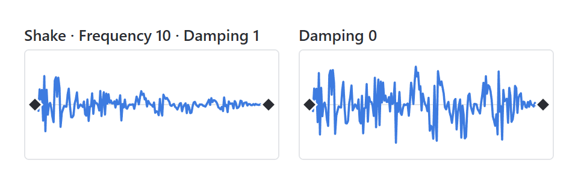

* The formulas are the same as LitMotion's `LMotion.Punch` and `LMotion.Shake`.
* Because it settles back into place, a Punch key usually comes right after a key at rest. For example, a key at 0 s (Scale 1) followed by a Punch key at 0.3 s (Strength 0.2) bumps around scale 1 and comes back to 1.

### Changing It in Code

To change the arrival on a particular play, use `With`. The change holds for that play only and goes back to the editor's value when it ends. It changes the track's last key (the segment that arrives at the end value).

```csharp
anim.With("Open").WithEase(panel, KeyTweenProperty.Scale, KeyTweenEase.OutBack).Play();
anim.With("Hit").WithShake(icon, KeyTweenProperty.AnchoredPosition, frequency: 20f, damping: 0.5f).Play();
```

When you make a state in code, set it per key with `Key(time, value, ease)`, `KeyCurve`, `KeyPunch` and `KeyShake`. For details, see the [API](API.md#making-a-state-in-code-build).

### Notes

* On a track whose Start is Current Value, the first segment starts from the value at play time. The arrival applies the same way.
* Tracks that switch on and off, such as Active, have no in-between values. They change right at the key's time.
* While playing, tracks that use only Ease are computed together with Burst. Tracks with Curve, Punch or Shake keys are computed in regular code. It makes a difference only when hundreds play at once. For details, see [Performance](Performance.md).

## 8. Track Options (Track Inspector)

Track options decide where the first key's value comes from and what the key values are measured against. Select a track to see them in the track inspector.


### Start

Sets where the first key's value comes from.

The problem this option deals with is a play that is cut short. Say a button is growing from 1 to 1.08 and the mouse leaves halfway (at 1.04), so Unhover plays. If Unhover's first key is the written value (1.08), the size jumps from 1.04 to 1.08 and then shrinks. If the first key is the value at the moment the play starts (1.04), the motion carries on from there.

| Value | Meaning |
|---|---|
| `Key Value` | The value written in the key |
| `Current Value` | The value at the moment playback starts |
| `Pointer (press position)` | Where the pointer that played the state was pressed. Only on the Position track of a UI object (RectTransform), and only when Play On is a pointer event |

* With `Current Value`, the value does not jump even when playback is cut short. This suits hover and unhover, or open and close.
* Use `Key Value` when the motion must start from the same place every time, such as an entrance that starts from 0.
* If the first key of a `Current Value` track is placed after 0 s, the track waits that long before it starts moving.
* With `Pointer`, the later keys are relative to the press point, so `(0,0)` means "the spot that was pressed". Use it for button ripples.

### Relative To Rest

Adds the key values to the original value.

An example is one "shrink a little when pressed" motion used on buttons of different sizes. Writing a value such as (200, 80) in a Size track fits only a button of that size. With Relative To Rest on and −(34, 17) written, every button shrinks by 34×17 from its own size.

The original value is:

* At runtime: the value at Awake
* In preview: the value when the preview starts

### Size Relative

Key values are read as multiples of the target's own size, so x = 1 means its own width. This option is for the Position and Size tracks of a UI object (RectTransform) only.

The motion therefore keeps the same proportions at any resolution. For example, a screen can slide in from one screen width to the right (x = 1) to 0.

### Options on Text Tracks

The options above belong to keyframe tracks. Text tracks have different options.

* A Reveal track has only Scramble.
* Per-character tracks have only Stagger and Duration per Char.
* The Start of Reveal and per-character tracks is always Key Value. A Number track has Start and Relative To Rest like any other track.

For details, see [Text Tracks](#9-text-tracks).

## 9. Text Tracks

Text tracks animate the characters of a TMP_Text. You can reveal characters one after another, count a number, or move each character on its own.

They are used for things like these:

* A typewriter in a dialogue box, one character at a time: Reveal
* Gold counting up from 0 on a reward screen: Number
* A title whose letters hop up one after another in a wave: per-character Position, Scale

Open the card of an object with a TMP_Text in the Add Track window to find these tracks.

In code: to count to a different number each time, give the end value with `With`. To skip the typewriter on a click, call `Complete`.

```csharp
anim.With("Count").WithEndValue(goldText, KeyTweenProperty.TextNumber, gold).Play();
anim.Complete("Type");   // shows the whole line at once
```

### Reveal (Typewriter)

Sets how many characters are visible, as a ratio from 0 to 1. Rich text tags are not counted as characters.

**Scramble** fills the characters that are not shown yet with random characters. Spaces in the original text are kept, so line breaks do not jump. Choose the character set from:

* Uppercase
* Lowercase
* Numerals
* All

### Number (Count)

Counts and changes only the **first number** in the text, and leaves the other characters as they are.

* Examples: `21/100`, `Lv. 3`
* Supports integers and thousands separators (`1,234`).
* With Start set to Current Value, counting starts from the number currently shown.

To set the end number at runtime, play the state with `With(state).WithEndValue(...)` from code (`SetEndValue` for a state that something else plays). The last key's value in the window then becomes a value for preview only. For details, see [API](API.md#setting-up-a-play-in-code-with).

### Per-Character Tracks

Char Scale, Char Position, Char Rotation, Char Color and Char Alpha are per-character tracks. Their keys describe **the motion of a single character**.

| Option | Meaning |
|---|---|
| **Stagger (s)** | The i-th character starts i × stagger seconds later |
| **Duration per Char (s)** | When greater than 0, the i-th character plays all of its keys over i × this value, in seconds |

On the timeline, the faint tail after the last key is the span in which the later characters play. Drag the end of the tail to change Stagger.

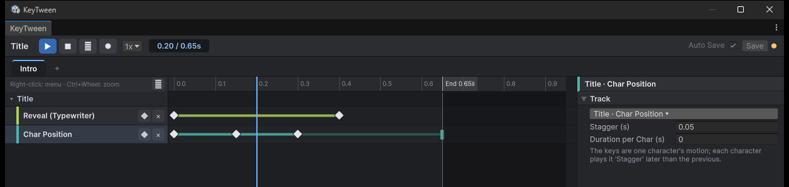

### Combining Per-Character Tracks

When the same text has several per-character tracks, their results are combined.

| Property | Combined by |
|---|---|
| Scale | Multiplying |
| Position, rotation | Adding |
| Color, alpha | Overwriting |

### Playing After Changing the Text

A state with text tracks reads the character count again when it plays. If you change the text and then play the state, the length and spacing follow the new text.

## 10. Events and Sounds

A state can signal your code or play a sound at a set time. Both are added as tracks from the Add Track window.

Use them to keep the game logic in time with the motion. For example, put a `Hit` event at 0.3 s of a sword swing (the moment the blade lands), and the code deals the damage and spawns the particles then. When the keys move, you move the event with them; there is no wait time in the code to fix.

### Adding an Event

1. Choose `Animation Events` in the Add Track window. An event track is created.
2. Click **+** on the track header, or double-click the row. Choose `Name Only` or a data struct in the menu, and the event is created.
3. In the inspector, set the **Name** and **Time (s)**. The kind can be changed later in the **Event Type** section below them.

Drag an event to move it.

### Event Type

The Type is one of the following:

* `Name Only`
* A struct marked with `[KeyTweenEvent]` in code

When you choose a struct, you can edit its fields right in the inspector. These field types can be edited:

* float, int, bool, string
* Vector2/3
* Color
* enum

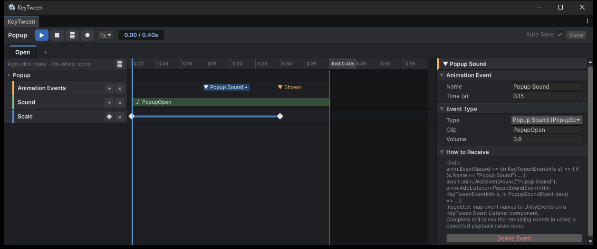

### Receiving Events

Receive events in either of these ways:

* In code. For details, see [API](API.md#animation-events).

  ```csharp
  anim.EventRaised += (in KeyTweenEventInfo e) => { if (e.Name == "Hit") DealDamage(); };
  await anim.WaitEventAsync("Hit");   // or wait for it once
  ```

* With the `KeyTween Event Listener` component, which connects a UnityEvent to each event name.

### Adding a Sound

1. Choose `Sound` in the Add Track window. A sound track is created.
2. Click **+** on the track header, double-click the row, or drop an AudioClip onto the row to add a sound.
3. In the inspector, set the **Clip**, **Volume** and **Time**.
4. Click **▶ Preview** to listen to it.

The length of the bar on the timeline matches the length of the clip.

### Which AudioSource Plays the Sound

The sound plays through the first AudioSource found in this order, so you do not need to add an AudioSource to every UI object:

1. **Audio Source (optional)** in the sound track's inspector
2. `KeyTween.audioSource`, set in code (it cannot be edited in the inspector)
3. If neither exists, a hidden shared 2D AudioSource

### Sounds and State Length

The state's length includes the end of the sound. As a result, the sound is not cut off when you Destroy the object after a close animation ends.

## 11. When States Overlap

Several states can play at the same time. For example, pressing a button while it is hovered plays both states together.

### Taking Over Properties

The new state takes over **only the properties it animates** from the earlier state, right where they are. The earlier state keeps playing the rest.

* A state that has handed over all of its properties stops, and its `PlayAsync` is canceled.
* Tracks whose Start is Current Value continue from where they stopped. This is why a hover that is cut short does not jump.

### Tracks That Write the Same Value

Tracks of different kinds that write the same value take over **only the part they share (the channels)**.

| Tracks that write the same value | Shared channels |
|---|---|
| Color and Alpha (Graphic, SpriteRenderer) | transparency (a) |
| Char Color and Char Alpha | transparency (a) |
| Position, Size and Offset Min, Offset Max (RectTransform) | the position and size an offset changes |
| Position and World Position, Rotation and World Rotation | all of it |

For example, when a button's `Hover` plays Color and `Fade` then plays Alpha:

* `Hover` keeps writing R, G and B.
* `Fade` takes the transparency.
* The other way round, when `Hover` starts during `Fade`, `Fade` has handed over its only channel, so it stops.

### Finishing the Earlier State First

Sometimes the earlier state must reach its end pose and raise its events before the next one plays. In that case, call `Complete("earlier state")` from code first, then play the next state.

```csharp
anim.Complete("Hover");   // moves the earlier state to its end pose
anim.Play("Press");
```

For details, see [API](API.md#playing).

## 12. Child Calls and Overrides (Nested Prefabs)

These features are for a shared prefab, such as a button, placed inside another prefab, such as a popup.

* **Child call**: the popup's state calls the button's state.
* **Override**: changes the button's animation only inside the popup.

### Adding a Child Call

A child call plays a state of a child prefab at a set time in the parent state.

1. Double-click an object row, or right-click and choose **Add Child Call ▸ child ▸ state**.
2. Drag the bar that appears on the parent's timeline to change its time.
3. In the inspector, set the **Child**, **State** and **Time**.

States that are already called are checked and cannot be chosen.

### How Child Calls Play

* The parent state's length includes `call time + child state length`.
* Calling `Complete` on the parent brings the child to its end values as well.
* If the parent is canceled, a child that has already started keeps playing.
* Cycles of states calling each other are cut off at depth 8.

### Overriding a Track

An override changes the child's animation per track, and only inside the current prefab. Under a child call, the child state's tracks are shown shifted by the call time. The original tracks are dimmed and read-only.

1. Click a dimmed track under the child call. **Only that track** is overridden.
2. Edit its keys. The edits go into the override, and the original prefab is not changed.

In the screenshot below, Popup's Open state calls OkButton's Hover at 0.2 s and overrides OkButton's Color track inside the popup only. The overridden Color track has a blue name and an **×**. The Scale track, not overridden, is dimmed. The child call's heading shows how many tracks are overridden and a **↺**.


### Editing the Original Prefab

Overrides are saved in the outer prefab's own `KeyTween`. Only the changed tracks are saved, so when you edit other tracks in the original, the popup picks up those changes.

| In the original prefab | Overridden track | Track not overridden |
|---|---|---|
| Change key values or times | The popup keeps its values | The popup follows |
| Add a track | — | It appears in the popup too |
| Delete a track | It stays in the popup | It is removed from the popup too |

### Overrides on Several Levels

When several levels, such as screen > popup > button, override the same track, **the outermost level wins**. This is the same rule as Unity's nested prefabs.

* Overridden tracks have blue names.
* Their tooltip shows which prefab overrides them.

### Reverting Overrides

| Control | What it reverts |
|---|---|
| **×** on a track | The outermost level of that track's override |
| **↺** on the child call title | All overrides at the outermost level (like Unity's Revert All) |
| **Inspector › Overrides › Revert** | Overrides made on a scene instance |

## 13. Preview

Preview lets you see how a state moves, right in the editor. Preview uses the same calculation as the runtime, so it gives the same result as real playback, including child calls and overrides.

### Playing a Preview

1. Select the state to preview in the state tabs.
2. Click **▶** in the top bar.

To see the pose at a given time, drag the ruler to scrub. The following shows a preview in the editor, without entering Play mode.


### Loop, Speed and Sounds

* **Loop**: Turn on **⟲**, or the state's Loop, to repeat.
* **Speed**: Choose from 0.1x to 1x.
* **Sounds**: Sounds that the playhead passes during playback are played. Scrubbing plays no sound.

### Behavior by Where You Preview

| Where | Behavior |
|---|---|
| Scene (Edit mode) | The changed properties are handed to Unity's `AnimationMode` |
| Prefab mode | The values at the start are remembered and restored when you stop |
| A prefab selected in the Project window | The prefab opens in Prefab mode and the same state is previewed there |
| Play mode | Values are written straight to the running objects and restored when you stop |

* In a scene, `AnimationMode` returns the properties to their original values when you stop, and they are not saved in the scene.
* When the prefab is saved in Prefab mode (Ctrl+S, or Auto Save in Unity's Prefab mode), it is saved with the original values. Then the same time is shown again.
* The prefab asset is not drawn in any view. Playing or scrubbing a prefab selected in the Project window therefore opens it in Prefab mode.

You can also preview in Play mode with the same window.


### Starting Pose Chosen Automatically

Some states only show their motion when they start from the pose in which another state ends. Such states are previewed from that pose. The pairs are:

* Play On pairs: PointerExit←PointerEnter, PointerUp←PointerDown, Deselect←Select, ToggleOff←ToggleOn
* Name pairs: Open↔Close, Show↔Hide, In↔Out

### When the Preview Stops

The preview stops when you:

* Click **■**
* Change the target or the state tab
* Delete the state
* Enter or leave Play mode
* Reload scripts
* Save or close the scene
* Close the window

## 14. Saving — Auto Save · Save

Your edits in the KeyTween window are saved wherever that `KeyTween` lives. The tooltips of **Auto Save** and **Save** show where the edits are saved.

### Auto Save and Save

| Control | Behavior |
|---|---|
| **Auto Save** | Saves automatically. On by default |
| **Save** | Saves when you click it |

* Pressing Ctrl+S (Cmd+S on Mac) while the window has focus does the same as Save.
* Auto Save saves 0.4 s after your last edit, so that it does not save every frame while you drag a value.
* Auto Save also saves any remaining edits when Play mode ends. Undo (Ctrl+Z) is saved the same way.
* With Auto Save off, edits are saved only when you click Save.

### Where Edits Are Saved

| What you edit | Where it is saved |
|---|---|
| An object in Prefab mode | That prefab |
| A prefab asset selected in the Project window | That prefab |
| A scene object (Edit mode) | The scene (with Unity's scene save) |
| In Play mode, a prefab copy created at runtime | The original prefab |
| In Play mode, an object placed in the scene | That scene object (applied when Play mode ends) |

When you edit a scene object in Edit mode, both controls are disabled and the tooltip explains why. Edits go straight into the object and are saved with Unity's scene save (Ctrl+S).

### Saving in Play Mode

* Prefab copies created at runtime include screens and list items. Other running copies of the same prefab get the same values immediately.
* Unity normally discards changes to an object placed in the scene. KeyTween applies them to that scene object when Play mode ends, and the scene file is written when you save the scene.
* In Play mode, edits that were not saved with Save while Auto Save was off are lost when Play mode ends.
* Editing part of a nested prefab in Play mode saves the change as an override in the outer prefab, and the inner prefab stays as it is.
* Objects in a scene that has never been saved (Untitled) cannot be found again after Play mode ends, so their edits are not applied.

For overrides, see [Child Calls and Overrides](#12-child-calls-and-overrides-nested-prefabs).

### Orange Dot

Like the `*` on a scene name, the orange dot appears while the values on screen are not saved. Its tooltip says which values these are.

* During preview
* When there are unsaved edits

## 15. Recording (●)

With recording on, you can create keys simply by changing an object in the Scene view or the Inspector. This works the same way as recording in the Unity Animation window.

### Recording Keys

1. Turn on **●** in the top bar. The button turns red.
2. Put the playhead at the time you want.
3. Change an object in the Scene view or the Inspector. The new value becomes a key.

The object itself returns to its value before the change, and the view shows the new key through preview. Each change is one Undo step.

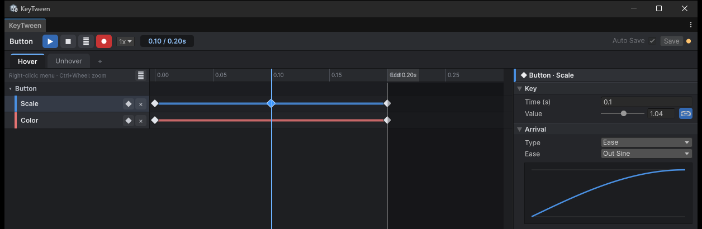

### How Recording Creates Keys

| Case | Result |
|---|---|
| Properties that have a track | A key is placed at the playhead. If a key already exists at that time, only its value changes |
| Properties without a track | A new track is created with a 0 s key (the value before the change) and a key at the playhead (the changed value) |

* For Relative To Rest and Size Relative tracks, the value is converted to that basis.
* Recording at 0 s switches Start to Key Value so that the first key uses the recorded value.

### Recorded Properties

A changed field is recorded onto the track that writes its value. Every track except those under "Not Recorded" is recorded (Transform, UI, TextMeshPro, SpriteRenderer, Light, Camera, AudioSource, UIEffect).

* If the state already has a track that writes the value, the key goes on that track. For example, with a World Position track, moving the object is recorded as World Position; with an Offset Min track, changing Position or Size is recorded as Offset Min; with a Scroll Position track, moving the Content is recorded as Scroll Position.
* Without such a track, the field's default track is created: Position for a position, Color for a color.
* If you change only the alpha of a Color and the same Graphic has an Alpha track but no Color track, the change is recorded as Alpha. With only an Alpha track, changing R, G or B creates a Color track.
* With a Number track, changing the number in the text is recorded as Number. Changing a text does not create a Number track.

### Not Recorded

* Material values: Material tracks and TextMeshPro's Outline Width, Outline Color, Face Dilate and Underlay Color. They change the material asset, not a field of the object.
* Reveal and per-character tracks
* Custom tracks that do not list their serialized fields. For details, see [Custom Tracks](API.md#custom-tracks).
* Tracks whose Start is Pointer
* Objects outside the `KeyTween` being edited in the window

### Saving Recorded Keys

Recorded keys are saved by Auto Save and Save as well. Recording also works in Play mode, and keys recorded on a runtime copy stay in the original prefab.

## 16. Context Menus and Shortcuts

These are the context menus and keyboard shortcuts available in the KeyTween window.

### Context Menus

| Where | Menu |
|---|---|
| State tab | Rename, Duplicate, Move Left, Move Right, Delete |
| Empty part of the timeline | Paste Keys at Playhead, Paste Keys Here, Add Track..., Add Child Call ▸ child ▸ state |
| Keyframe track header | Add Key at Playhead, Remove Track (on an override track: Revert Track to Original) |
| Keyframe row | Add Key Here, Copy Selected Keys, Paste Keys at Playhead, Paste Keys Here, Delete Selected Keys, Remove Track |
| Event or sound track header | Add Event / Sound at Playhead, Remove Track |
| Event or sound marker | Delete |
| Child call | Revert All (outermost overrides), Remove Child Call |

### Shortcuts

| Key | Action |
|---|---|
| Ctrl+S (Cmd+S) | Save |
| Ctrl+C / Ctrl+V (Cmd+C / Cmd+V) | Copies the selected keys / pastes them at the playhead |
| Delete / Backspace | Deletes the selected keys and markers |
| F | Frame all |
| Esc | Closes the context menu |

* When you are editing a scene object in Edit mode, Ctrl+S runs Unity's scene save instead.
* You can change the Save shortcut at `KeyTween/Save` in **Edit > Shortcuts**.

Every edit can be undone with Unity's Undo.
