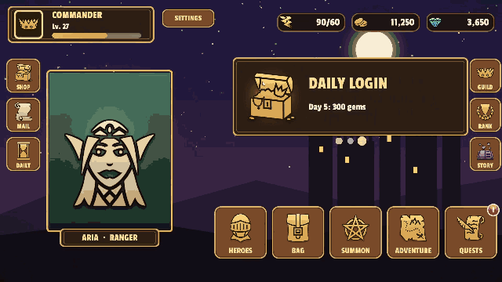

# Screen Transitions — Page · Modal · Sheet

KeyTween includes components that manage the screen flow of a game UI: pages that you stack and go back from, popups (modals) shown on top, and sheets that you switch between like tabs. They do the job of UnityScreenNavigator without a separate package.

A transition is a **`KeyTween` state** on the screen prefab. A state is one named animation stored on a `KeyTween` component. If the screen has no state with the expected name, the built-in default transition is used.

Every transition returns a Unity `Awaitable`, so you can `await` it without third-party libraries.

## 1. Screen — `KeyTweenScreen`

`KeyTweenScreen` represents one screen that can be a page, a modal or a sheet.

### Making a Screen Prefab

1. Select the root of the screen prefab.
2. Choose **Add Component > KeyTween > Screen**.

The same object also needs these components:

* `RectTransform`
* `CanvasGroup`
* `KeyTween`

A screen created by a container fills the container.

### Drawing Order — `renderingOrder`

* In a page container, a page with a higher value draws on top.
* Pages with equal values stack in the order they were added.
* In modal and sheet containers, the screen added last is always on top.

### Transitioning Without Animation

A transition with `animated: false` skips the animation and jumps straight to the state's end pose.

## 2. Containers

Screens are created and managed by a container. There are three kinds of container, and each looks for different state names on the screen and has its own default transition.

| Container | Screens | Default transition (0.3 s) |
|---|---|---|
| `KeyTweenPageContainer` | Pages you stack and go back from | Slide by one screen width (Size Relative), OutQuart |
| `KeyTweenModalContainer` | Modals shown on top | Scale 0.3 → 1 with alpha (OutQuart); the backdrop fades its alpha (Linear) |
| `KeyTweenSheetContainer` | Sheets you switch between | Alpha fade (Linear) |

### Pages — `KeyTweenPageContainer`

* API: `Push(prefab, animated, stack)`, `Pop(animated)`, `Pages`, `Current`
* State names: `PushEnter`, `PushExit`, `PopEnter`, `PopExit`

```csharp
await pages.Push(loadingPage, stack: false);   // loading screen: removed from history and destroyed when the next page comes in
await pages.Push(homePage);                     // the loading screen stays visible while Home prepares in WillEnter
```

`Push` runs in this order:

1. It creates the new page.
2. It waits for the `Will*` methods of both the incoming and the outgoing page.
3. It plays `PushEnter` and `PushExit` **at the same time**.
4. It deactivates the outgoing page when they finish.

* A page pushed with `stack: false` is removed from history and destroyed when the next page comes in. Use it for a loading screen.
* `Pop` reactivates the previous page, plays `PopEnter` and `PopExit`, and then destroys the current page.
* `Pop` does nothing if there is no page.

The RPG sample uses `Push` to go from the lobby to a hero's detail page and from there to the upgrade page, and `Pop` to come back.


### Modals — `KeyTweenModalContainer`

* API: `Push(prefab, animated)`, `Pop(animated)`, `Modals`, `Current`, `backdropPrefab`
* State names: `Enter`, `Exit` (the backdrop also uses `Enter`/`Exit`)

```csharp
await modals.Push(confirmPopup);
await modals.Pop();
```

* Each modal gets its own backdrop.
* If `backdropPrefab` is empty, a black backdrop at 75% opacity is created.
* Modals underneath do not move, and their lifecycle methods are not called.
* `Pop` plays `Exit`, then destroys the modal and its backdrop.

The Daily Attendance window in the RPG sample is opened with the modal container. While the window comes in, the backdrop darkens the lobby behind it.


### Sheets — `KeyTweenSheetContainer`

* API: `Register(prefab)`, `Show(index, animated)`, `Sheets`, `ActiveIndex`, `Active`
* State names: `Enter`, `Exit`
* State names when going to a lower index: `EnterBackward`, `ExitBackward` (`Enter`/`Exit` if missing)

```csharp
var tab = sheets.Register(shopTabPrefab);
await sheets.Show(tab);                         // to a higher index: Enter, to a lower index: EnterBackward
```

* `Register` creates a sheet, keeps it hidden and returns its index.
* `Show` does nothing when given the current index or an index out of range.
* The outgoing sheet is deactivated.

### Default Transition Values

The default values match UnityScreenNavigator's defaults. You can also use them directly in code through `KeyTweenDefaultTransitions`:

* `PagePushEnter` and so on
* `Slide`
* `FadeIn` / `FadeOut`

## 3. Input Blocking

While a transition is running, **touch input is blocked on every container**, so rapid taps cannot start overlapping transitions.

### Checking for a Running Transition

* `KeyTweenScreenContainer.AnyInTransition` tells whether any container is in a transition.
* `IsInTransition` tells whether a particular container is in a transition.

### How Input Is Blocked

Input is blocked through each container's `CanvasGroup.blocksRaycasts`.

* `interactable` is left unchanged, so buttons do not switch to their disabled color during a transition.
* A container object needs a `RectTransform` and a `CanvasGroup`.

## 4. Lifecycle — `IKeyTweenScreenLifecycle`

Use this interface to run code when a screen enters or exits.

### Implementing Lifecycle Methods

If any component on the screen root implements it, its methods are called on every transition. Every method has a default implementation, so you only write the ones you need.

```csharp
public sealed class HomePage : MonoBehaviour, IKeyTweenScreenLifecycle
{
    public async Awaitable WillEnter(KeyTweenTransition t) { await LoadAsync(); }   // called before the animation and awaited
    public void DidEnter(KeyTweenTransition t) { }                                  // after the animation
    public Awaitable WillExit(KeyTweenTransition t) => KeyTweenScreen.Completed();    // when there is nothing to await
    public void DidExit(KeyTweenTransition t) { }
}
```

### Transition Info — `KeyTweenTransition`

The `KeyTweenTransition` passed to each method has the following properties.

| Property | Description |
|---|---|
| `Kind` | The kind of transition: Push, Pop, Show or Hide |
| `Partner` | The other screen in the transition |
| `Backward` | Whether the transition goes backward |
| `Animated` | Whether the transition plays its animation |

`Backward` is true for these transitions:

* Pop for pages and modals
* A move to a lower index for sheets

## 5. Shared Element Transition — `KeyTweenSharedElement`

A shared element transition connects two screens through one element. For example, a portrait in a list moves into the portrait's place on the detail screen and grows as it goes.

### Making a Shared Element Transition

You make the motion in the editor, and fill in the place on the other screen, which is known only at runtime, from code.

1. Add a **Position track and a Size track** to the moving image and set keys on them.
2. In a `Will*` method, fill in only the key for the place on the other screen (the first key or the last key).

```csharp
// RPG sample RpgHeroDetail: the hero card's portrait (card) moves into the detail screen's portrait (portrait)
public Awaitable WillEnter(KeyTweenTransition t)
{
    KeyTweenSharedElement.SetPartnerKeys(GetComponent<KeyTween>(), "PushEnter", portrait.rectTransform, card, atStart: true);
    card.GetComponent<Image>().enabled = false;   // hide the card's image; show it again after returning from the detail screen
    return KeyTweenScreen.Completed();
}

public Awaitable WillExit(KeyTweenTransition t)
{
    if (t.Kind == KeyTweenTransitionKind.Pop)       // going back: the last key goes to the card's place
        KeyTweenSharedElement.SetPartnerKeys(GetComponent<KeyTween>(), "PopExit", portrait.rectTransform, card, atStart: false);
    return KeyTweenScreen.Completed();
}
```

### `SetPartnerKeys`

`SetPartnerKeys(animation, state, moving, partner, atStart)` converts the rectangle that `partner` occupies on screen into a position and size for `moving`.

* It writes them to keys of the Position and Size tracks.
* With `atStart` true it writes the first key, otherwise the last key.
* It assumes that `moving` has point anchors (not stretch).

### Examples

* The hero card to detail screen transition in the RPG sample
* The bag slot to item info popup transition
* The portrait viewer in the ScreenNavigator recreation

In the bag of the RPG sample, tapping a slot carries the item icon into its place in the item info popup.


