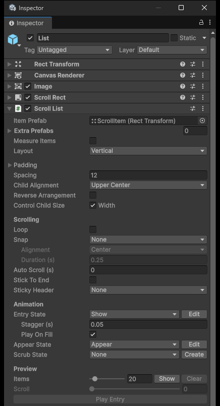
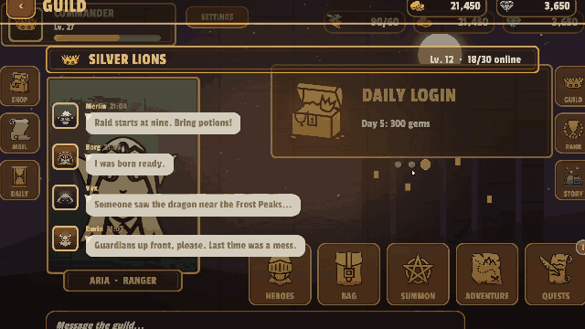
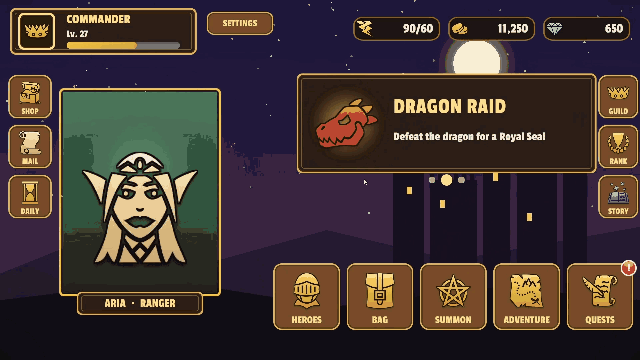

# Scroll List — `KeyTweenScrollList`

`KeyTweenScrollList` is the component for UI that scrolls through many entries, such as rankings, quest lists, chats, carousels and banners.
It is a **virtualized list** that you add to a `ScrollRect`. Only the visible items exist as objects, and those objects are reused as you scroll, so the object count stays at what fits on screen even with hundreds of entries.

There is no separate component for each scroll style. Vertical lists, grids, carousels, wheel pickers and the other styles are all combinations of this list's settings.

Every animation is a **`KeyTween` state** on the item (or on a page dot or section header). A state is one named animation stored on a `KeyTween` component.

To add it, select the object that has the `ScrollRect` and choose **Add Component > KeyTween > Scroll List**.

## 1. Items and Layout

This section explains how to set the item prefabs and the layout. The list's inspector is organized like a Unity Layout Group.

### Setting the Item Prefabs

| Item | Description |
|---|---|
| Item Prefab | The default item prefab (number 0). Its size is the default item size. |
| Extra Prefabs | Additional prefabs for lists with several kinds of items (numbered from 1) |
| Measure Items | Measures each item from its layout preferred size. |
| Layout | One of Vertical, Horizontal, Grid and Masonry |

* You pick the kind from Extra Prefabs in code with `prefabOf(index)`. Each kind is pooled separately.
* Use Measure Items for a chat bubble that grows with long text.



### Choosing a Layout

Each layout has the following settings.

| Layout | Settings |
|---|---|
| Vertical / Horizontal | Padding, Spacing, Child Alignment, Reverse Arrangement, Control Child Size |
| Grid | Padding, Cell Size, Spacing, Child Alignment, Constraint, Constraint Count |
| Masonry | Same as Grid, but with Column Size (column width) instead of Cell Size |

* Control Child Size takes Width or Height and stretches items across the scroll direction.
* Grid's Constraint is one of Flexible, Fixed Column Count and Fixed Row Count.
* Masonry places each item on the shortest column.

### Scroll Direction and Item Size

* The layout determines the scroll direction. A Grid with Fixed Row Count scrolls horizontally.
* The item size along the scroll direction comes from the following, in order. Grid always uses Cell Size.
  1. The `sizeOf(index)` callback
  2. Measure Items
  3. The prefab size
* When the content is shorter than the viewport, Child Alignment also applies along the scroll direction. A chat, for example, uses Lower so that messages stack from the bottom.

### Layout Cost

Item positions are computed once whenever the layout changes, without a `LayoutGroup`. The list costs nothing while it is not scrolling.

## 2. Binding Data

This section explains how to connect data to the list. You bind data with callbacks, as with UI Toolkit's `ListView`.

### Binding with Callbacks

The item prefab does not need a base class. `ItemView` in the code below stands for any component on the prefab.

```csharp
list.SetCount(100, (ItemView view, int index) => view.Set(items[index]),
                   (ItemView view, int index) => view.Clear());          // unbind is optional
list.SetData(items, (ItemView view, Item item, int index) => view.Set(item));
```

* The binding callback is called only when an item becomes visible.
* Calling `SetCount` or `SetData` with bindings refills the list from scratch.
* A refill returns the scroll position to the start, or to the end when Stick To End is on.
* With Play On Fill, the entry animation also plays.

### Using Several Prefab Kinds

With several prefab kinds, take a `RectTransform` and pick the kind for each index with `prefabOf`.

```csharp
list.prefabOf = i => items[i].isHeader ? 1 : 0;                          // set before SetCount
list.SetCount(48, (RectTransform item, int index) => ...);               // with several prefabs
```

### Changing the Count and Rebinding

Changing only the count, without bindings, keeps the scroll position. The remaining items keep their objects and are bound again, without playing Appear again.

```csharp
list.SetCount(10);      // count only: keeps the scroll position, rebinds the remaining items, only newly visible ones Appear
list.Refresh();         // rebinds every visible item (and re-measures with Measure Items)
list.RefreshItem(5);
```

* `SetCount(count, stickDuration = 0.25f)`, which changes only the count, measures only the new items.
* If Stick To End is on and the end was in view, the list slides to the new end over `stickDuration` seconds.

### Example: Guild Chat

The guild chat in the RPG sample only raises the count when a message arrives.

* Each bubble is sized to its text (Measure Items).
* The list keeps the newest message in view (Stick To End).



## 3. Position and Scrolling

This section explains how to read the list's current state, move to a specific item and set how the list scrolls.

### Reading the State

| API | Description |
|---|---|
| `Count` | The item count |
| `VisibleRange` | The visible range |
| `Offset` | The pixels scrolled from the start |
| `AtEnd` | Whether the list is at the end |
| `ItemSize` | The default item size |
| `GetItem(index)`, `GetItem<TView>(index)` | The item's object if it is visible, otherwise null |
| `IndexAt(screenPoint, camera)` | The index of the item under a screen point (such as the pointer), or −1 |
| `ItemPosition(index)`, `SizeOf(index)` | An item's position and size |
| `NearestIndex(alignment)` | The item nearest to an alignment point |
| `CurrentIndex`, `CurrentIndexChanged` | The item at the Snap Alignment point |
| `ItemShown` | Raised when an item becomes visible (after binding) |
| `ItemHidden` | Raised when an item is hidden (before unbinding) |

Use `CurrentIndex` for the current page or the selection of a carousel or wheel picker.

### Scrolling to an Item

`ScrollTo(index, alignment = Start, duration = 0)` aligns the item to the start, center or end of the viewport.

* The move uses OutCubic.
* A duration of 0 jumps instantly.
* With Loop, it goes the shorter way.

### Folding and Removing Items

`ResizeItem(index, size, duration)` animates one item's size while the items after it follow (accordion). Call `RemoveItem(index)` after removing one entry from your data.

```csharp
await list.ResizeItem(index, 0f, foldSeconds);   // fold; the Awaitable completes when the animation ends
items.RemoveAt(index);                           // remove the entry from your data
list.RemoveItem(index);                          // only that item goes away
```

* After `RemoveItem`, the items below move up one slot.
* They keep their objects and animation state.
* They are not rebound and do not play the appear animation.

### Replaying and Rebuilding

* `PlayEntry()` replays the entry animation.
* `Rebuild()` recomputes the layout.

### Scrolling Settings

| Setting | Description |
|---|---|
| Loop | The first item follows the last one. |
| Snap: None | No snapping. |
| Snap: Nearest | Snaps to the nearest item on release. |
| Snap: One Per Swipe | Moves exactly one item per drag. |
| Snap Alignment / Duration | Where items snap to / how long the snap takes |
| Auto Scroll (s) | Moves to the next item every N seconds (banner). |
| Stick To End | When items are added while the end is in view, the list stays at the end (chat). |
| Sticky Header | Uses the chosen prefab kind as a section header. |

* Loop and Sticky Header work with Vertical and Horizontal only.
* With One Per Swipe, a drag under 30 px returns to where it was.
* Auto Scroll pauses while the user drags.
* With Sticky Header, a header that has scrolled past stays pinned at the top until the next header pushes it up.

### Nested Scrolling

A drag across the list's scroll axis is passed to the enclosing `ScrollRect`. This is how these layouts behave:

* A vertical list inside a page
* A horizontal row inside a vertical list

### Example: Quest List

The quest list in the RPG sample pins its section headers with Sticky Header.

* Section headers: DAILY, WEEKLY, ACHIEVEMENTS
* A row whose reward has been claimed is folded with `ResizeItem` and then removed with `RemoveItem`.



## 4. Item Animation

This section explains the animations items play when they come in and as they scroll. You pick the states from the item prefab's `KeyTween`.

### Editing States

The buttons on each state row let you edit a state right away.

* **Edit** opens that state in the KeyTween Editor.
* **Create** adds the `KeyTween` and the state if they are missing, then opens it.

For a prefab asset, Prefab Mode opens first.

### Entry Animation — Entry State

Entry State works together with Stagger and Play On Fill. On the first fill (or when you call `PlayEntry()`), the visible items play one after another, Stagger apart.

* Items still waiting for their turn show the state's start pose.
* Items that come in after the entry animation has finished show its end pose.

### Appear Animation — Appear State

Plays on an item that becomes visible by scrolling. It does not play in these cases:

* On the first fill
* On items that come into view because another item was resized or removed

A reused object may still look like its previous index. So when an item becomes visible, the list first sets it to the entry state's end pose and then plays the appear state.

### Position-Driven Animation — Scrub State

Uses the item's position in the viewport as the state time and applies the pose at that time (`Stop(state, time)`).

* 0 = start edge
* 0.5 = center
* 1 = end

These values are fractions of the state's length, so put the keys at 0 s, half the state's length and its full length. For example, a carousel whose center item grows, with a state 1 s long, has Scale keys at 0 s = 0.8, 0.5 s = 1.1 and 1 s = 0.8.

Use it for carousel zoom, wheel picker tilt and page parallax.

### Callbacks

* Entry and Appear are plays, so their states' On Start and On Complete are called. If an item leaves the view while playing and its object is reused, On Cancel is called.
* Scrub only sets the pose without playing, so it calls no callbacks.

### Example: Ranking List

* Rows come in one after another when the page opens.
* Rows that scroll into view play the appear animation.
* The MY RANK button uses `ScrollTo` to move to the player's row.


## 5. Editor Preview

The **Preview** section of the inspector lets you check the list without entering Play Mode.

### Using the Preview

It is available in Edit Mode when an Item Prefab is set.

* **Show** / **Update** lays out the number of items set in Items (1–200).
* The **Scroll** slider changes the scroll position, including the effect of scrub states.
* **Play Entry** plays the entry animation.
* **Clear** removes the temporary objects.

The laid-out items are temporary objects that are not saved.

## 6. Helper Components

This section covers three components that work together with the list. Their animations are also `KeyTween` states, and the **Edit** / **Create** buttons on their state fields open the KeyTween Editor directly.

| Component | Use | States |
|---|---|---|
| `KeyTweenPageIndicator` | Page dots, banner dots, tab bars | On / Off |
| `KeyTweenScrollScrub` | A header that collapses as you scroll | Any one state |
| `KeyTweenPullToRefresh` | Pull to refresh | Pull / Refreshing |

### Page Dots and Tab Bars — `KeyTweenPageIndicator`

* It creates one indicator item from its prefab for each list item.
* This object's Layout Group lays them out.
* Pressing an indicator item's Button scrolls the list to that item.
* Set tab text with `labels`.

### Collapsing Header — `KeyTweenScrollScrub`

Uses the scroll distance (0 to Distance px) as the state time. At 0 px the state is at its start; scrolled by Distance, it shows its end pose. Use it for a header that collapses or a toolbar that appears as the list scrolls.

1. Add **Add Component > KeyTween > Scroll Scrub** to any object.
2. Put the list in **List**, the header's `KeyTween` in **Target** and the name of the collapsing state in **State**.
3. Set **Distance** to the scroll distance (px) at which it is fully collapsed.

### Pull to Refresh — `KeyTweenPullToRefresh`

Add it to the same object as the list. It works with vertical lists only.

1. When you pull past the start, the Pull state follows how far you pull.
2. Releasing past Distance calls `onRefresh`.
3. While refreshing, it loops the Refreshing state and keeps the top open (`Refreshing` = true).
4. Calling `EndRefresh()` closes it.

```csharp
pull.onRefresh.AddListener(async () =>
{
    var items = await LoadItemsAsync();
    list.SetData(items, (ItemView view, Item item, int index) => view.Bind(item));
    pull.EndRefresh();
});
```

## 7. What You Can Build

This section lists the patterns you can build from the list's settings and states.

### Opening the Example Scene

The **UI Components** sample (**Package Manager > KeyTween > Samples**) contains 18 examples in `Scenes/Scroll.unity`.

### Settings for Each Pattern

| Pattern | Settings / States |
|---|---|
| Vertical list, horizontal list, grid, horizontal grid | Layout, Entry `Show` + Appear `Appear` |
| Carousel | Scrub `Focus` (zooms the center item), Snap Nearest Center |
| Paging | One Per Swipe, Scrub `Parallax`, Page Indicator |
| Infinite loop | Loop + Scrub + Snap |
| Auto banner | Loop + One Per Swipe + Auto Scroll + Page Indicator |
| Wheel picker | Scrub `Wheel` (Rotation X, alpha, scale), Snap Nearest Center |
| Section headers | Two prefab kinds, Sticky Header |
| Variable size, chat | Measure Items (+ Stick To End, Lower alignment) |
| Accordion | `Open`/`Close` states + `ResizeItem` |
| Masonry | Masonry |
| Nested scroll | A horizontal list in each row of a vertical list |
| Tabs | Page Indicator (On/Off underline) + One Per Swipe |
| Collapsing header | Scroll Scrub |
| Pull to refresh | Pull To Refresh |
