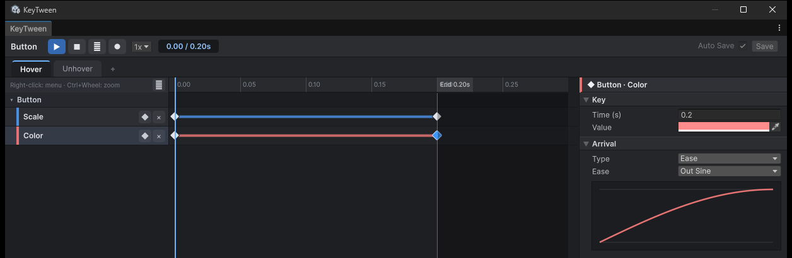
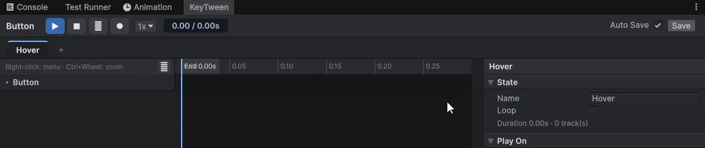
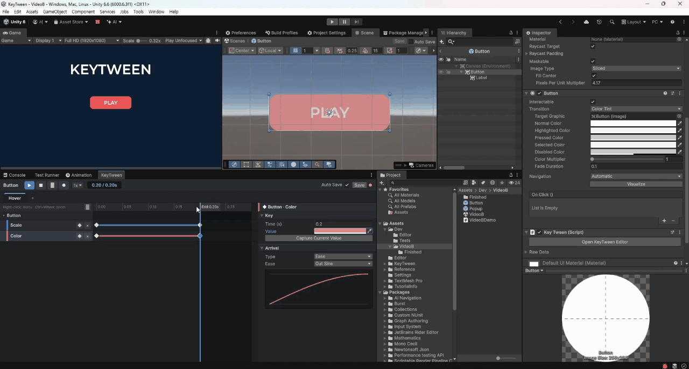
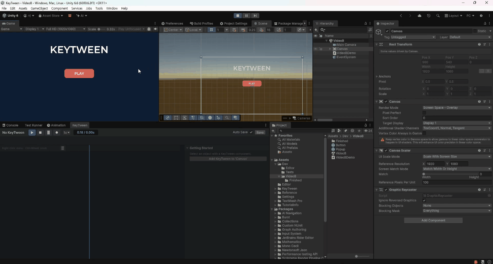
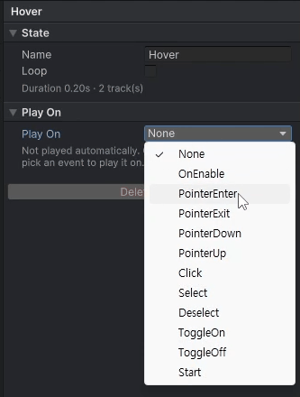
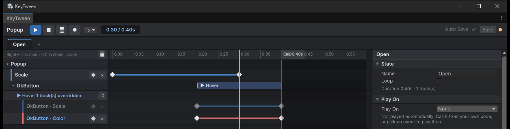
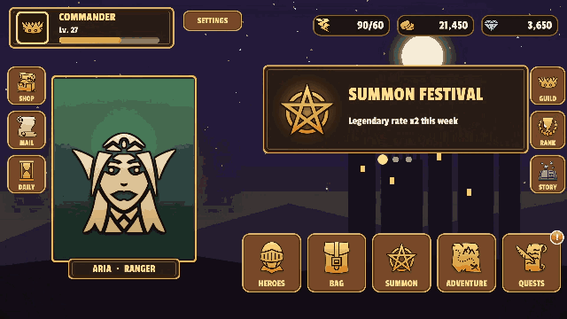
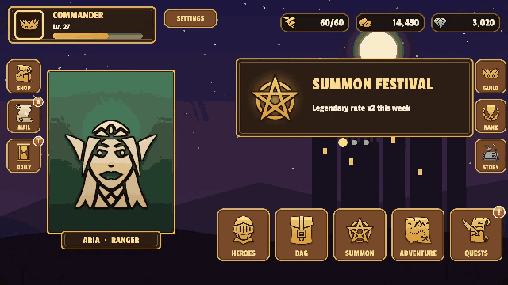

# KeyTween

KeyTween is a keyframe UI animation tool for Unity uGUI. You author animations on a timeline, store them in the prefab, and play them by name.

[](https://unity.com/releases/editor/archive)
[](https://github.com/UnialGames/KeyTween/releases)
[](LICENSE.md)

[Document](https://unialgames.github.io/KeyTween/) · [한국어 README](README_KO.md)


## Overview

KeyTween lets you build UI animation the same way you build an Animator clip: by placing keys on a timeline. Unlike a clip, the animation is stored **inside the prefab** as named states such as `Hover`, `Open` and `Close`.

### Key Features

* **No extra assets.** There are no clip or controller assets, and each track refers directly to a component in the prefab.
* **Authoring in the editor.** You build animations in the KeyTween window with the Add Track picker, the key inspector and recording.
* **Preview without Play mode.** Previews work in Edit mode, Prefab mode and Play mode.
* **UI and game objects.** Besides UI, tracks animate world-space objects: Transform, SpriteRenderer, material properties, Light, Camera and AudioSource. You can add your own tracks for any component.
* **Choose when a state plays without code.** Each state can play on pointer enter, on click, on enable and so on.
* **One line of code.** `await anim.PlayAsync("Open")` plays a state and returns a Unity `Awaitable`. Clear rules define how a play ends when it cannot finish.
* **Built for prefabs.** States are saved with the prefab. A parent prefab can call a state of a nested prefab and override its tracks. The override applies only inside the parent.
* **Tween-level performance.** KeyTween costs nothing while idle and allocates no GC memory while playing. Ease tracks are evaluated with Burst.

### Videos

To see KeyTween in action, watch these videos:

* [RPG Sample](https://youtu.be/79Aw-O2kEgA)
* [Button hover in the editor](https://youtu.be/13JJNE4_FwI)
* [Overriding a button inside a popup](https://youtu.be/rXO_kNexiGc)

## Table of Contents

- [Installation](#installation)
- [Getting Started](#getting-started)
- [Playing and Awaiting](#playing-and-awaiting)
- [When States Overlap](#when-states-overlap)
- [Changing End Values at Runtime](#changing-end-values-at-runtime)
- [Animation Events](#animation-events)
- [Playing Without Code (Play On)](#playing-without-code-play-on)
- [Nested Prefabs: Child Calls and Overrides](#nested-prefabs-child-calls-and-overrides)
- [Sampling, Reading and Writing Values](#sampling-reading-and-writing-values)
- [Scroll List](#scroll-list)
- [Screen Transitions](#screen-transitions)
- [Integrations (UniTask, R3, UIEffect)](#integrations-unitask-r3-uieffect)
- [Samples](#samples)
- [Performance](#performance)
- [Documentation](#documentation)
- [License](#license)

## Installation

This section explains how to install KeyTween in your project.

### Requirements

* Unity 6000.0 or later
* Installed along with KeyTween
  * `com.unity.ugui` 2.0.0 (includes TextMeshPro)
  * `com.unity.mathematics` 1.3.2
  * `com.unity.burst` 1.8.25

### Install via Package Manager (Recommended)

Install KeyTween from its Git URL in the Package Manager.

1. Open **Window > Package Manager**.
2. Click the **+** button and select **Add package from git URL...**.
3. Enter the following URL:

```text
https://github.com/UnialGames/KeyTween.git
```

Alternatively, add the following line to the `dependencies` block of `Packages/manifest.json`:

```json
{
  "dependencies": {
    "com.unialgames.keytween": "https://github.com/UnialGames/KeyTween.git"
  }
}
```

### Updating

The URL above always points to the latest release. When a new version is out, select KeyTween in the Package Manager and click **Update**.

### Installing a specific version

Add `#` and a version tag to the URL to stay on that version. All versions are listed on the [Releases](https://github.com/UnialGames/KeyTween/releases) page.

```text
https://github.com/UnialGames/KeyTween.git#v0.2.0
```

* A pinned version does not change when you click **Update**.
* To change the version, edit the tag in `Packages/manifest.json`.
* To follow the latest release again, remove `#v…` from the URL.

### Importing samples

1. Select KeyTween in the Package Manager.
2. Open the **Samples** tab and click **Import** next to a sample.

Samples are copied into your project. After updating the package, import them again to get the new version.

## Getting Started

This section walks you through your first animation in the editor, and then shows how to play a state from code. A *state* is a named animation, such as `Hover` or `Open`, stored in the `KeyTween` component on a prefab.

### 1. A hover effect, in the editor

In this example, the button grows to 1.1× and becomes lighter when the pointer enters it, and returns to normal when the pointer leaves. You do not write any code.

When you finish, the KeyTween window shows the following:

* The `Hover` and `Unhover` states
* The button's Scale and Color tracks with their keys
* The key inspector on the right



1. Open the button prefab, then open **Window > KeyTween Editor**.
2. Click **Add KeyTween to 'Button'**. You can also add the `KeyTween` component yourself.
3. Click **+** in the state tabs to add a state, and name it `Hover` in the state inspector. A new state starts with an empty timeline, and the state inspector shows its Name, Loop, Duration and Play On settings.

   

4. Right-click an empty part of the timeline and choose **Add Track…**.
5. Pick **Scale** under `RectTransform` and **Color** under `Image`, then click **Add 2**. Each track is created with a key at 0 s and an end key at 0.2 s.

   

6. Click the Scale track's end key and set Value to `1.1` and Ease to `OutBack`.
7. Set the Color track's end key to a lighter color.
8. Drag the ruler or press **▶** to preview the animation. You do not need to enter Play mode.

   

9. In the state inspector, set **Play On** to `PointerEnter`.
10. Create an `Unhover` state the same way. Set its end keys back to `1` and the original color, and set its Play On to `PointerExit`.
11. Enter Play mode and move the pointer onto the button and off it again.

    

A full video of these steps is available: [Button Hover Editor](https://youtu.be/13JJNE4_FwI). For details on the editor, see the [Guide](Docs~/en/Guide.md).

### 2. Playing it from code

To play a state from a script, reference the `KeyTween` component and call it with the state name. This popup plays `Open` when it opens, and destroys itself after `Close` finishes:

```csharp
using System;
using KeyTweening;
using UnityEngine;

public class Popup : MonoBehaviour
{
    [SerializeField] KeyTween anim;

    public async Awaitable Open() => await anim.PlayAsync("Open");

    public async Awaitable Close()
    {
        try { await anim.PlayAsync("Close", cancellationToken: destroyCancellationToken); }
        catch (OperationCanceledException) { return; }   // reopened while closing: keep the popup
        Destroy(gameObject);
    }
}
```

The editor and the code split the work as follows:

* The editor defines the animation itself. This includes its timing, eases and animated properties.
* The code only decides *which state* to play and *what happens after* it ends.

For details, see [Playing](Docs~/en/API.md#playing).

## Playing and Awaiting

A `KeyTween` component plays its states by name. This section covers the playback methods and the rules for how a play ends.

### Main Methods

```csharp
anim.Play("Hover");                                // plays without waiting; applies the 0 s pose immediately
await anim.PlayAsync("Open");                      // completes when the state ends (or on Complete)
await anim.PlayReversedAsync("Open");              // plays end to start; events, sounds and child calls run in reverse
anim.Complete("Typewriter");                       // jumps to the end, raising the remaining events in order
anim.Stop("Idle");                                 // stops at the current pose; a waiting PlayAsync is canceled
anim.Sample("Collapse", 0.25f);                    // shows the pose at a given time, without playing
bool playing = anim.IsPlaying("Open");
float length = anim.Duration("Open");              // includes overrides; 0 if the state does not exist
```

* Playback follows `Time.timeScale` by default, so pausing the game pauses it. For UI that must keep moving while the game is paused (a pause menu), set the KeyTween's **Time** to `Unscaled`.
* If no state has the given name, KeyTween logs a warning and the call completes immediately.

### How a Play Ends

A `PlayAsync` call ends differently in each case:

| Case | `PlayAsync` | Remaining events | Remaining sounds |
|---|---|---|---|
| Reaches the end | completes | all raised | all played |
| `Complete` | completes | raised in order | not played |
| Another state takes all of its properties | **canceled** | not raised | not played |
| The same state is played again | earlier play **canceled** | not raised | not played |
| Object disabled, `Stop`, token canceled | **canceled** | not raised | not played |

* A canceled play throws `OperationCanceledException`.
* As a result, the code after an `await` runs only when the state has really finished. This is usually what you want.
* A looping state's `PlayAsync` ends only when you call `Complete` or `Stop`.

For details, see [How a Play Ends](Docs~/en/API.md#how-a-play-ends).

### Example: A Dialogue Box

To show the next line, change the text and play the same typewriter state again. To let the player skip the typing, call `Complete`.

```csharp
dialogue.text = nextLine;
var typing = anim.PlayAsync("Typewriter");
// skip button: anim.Complete("Typewriter");
await typing;
```

### Awaiting Several KeyTweens Together

`PlayAsync` returns a Unity `Awaitable`, not a `Task`, so you cannot pass it to `Task.WhenAll` directly. Each play starts as soon as it is called, so start all of them first and then await them one by one:

```csharp
var plays = anims.Select(a => a.PlayAsync("Hover")).ToList();   // all of them start here
foreach (var play in plays) await play;                         // waits until every play has ended

// or convert them to Tasks:   static async Task AsTask(Awaitable a) => await a;
await Task.WhenAll(anims.Select(a => AsTask(a.PlayAsync("Hover"))));

// or use UniTask:
await UniTask.WhenAll(anims.Select(a => a.PlayUniTaskAsync("Hover")));
```

For details, see [Awaiting Several KeyTweens Together](Docs~/en/API.md#awaiting-several-keytweens-together).

## When States Overlap

Several states of one `KeyTween` can play at the same time. This section explains how states share properties.

### How Properties Are Taken Over

* When a new state starts, it takes over **only the properties it animates**.
* It picks up each property from its current value and continues from there. A hover that is cut short therefore does not jump.
* The other states keep playing the properties they still own. For example, if the button is pressed while the hover is playing, the hover keeps animating the properties that the press does not use.
* A state that loses all of its properties stops, and its `PlayAsync` is canceled.

### Finishing a State Before the Next One

To finish a state before you start the next one, call `Complete` on it first. The state then reaches its end pose, raises its remaining events, and its `await` completes:

```csharp
anim.Complete("Open");    // Open jumps to its end; an await on it completes and its "Shown" event is raised
anim.Play("Close");       // then Close starts from the open pose
```

For details, see [When States Overlap](Docs~/en/Guide.md#11-when-states-overlap).

## Changing End Values at Runtime

Some values are known only at runtime, such as an amount of gold or a power rating. For these, create the motion in the editor and pass only the end value from code.

### Passing an End Value

```csharp
// "Count" state on the gold label: a Number (Count) track, 0.6 s OutQuad, made in the editor
counter.SetEndValue("Count", goldLabel, KeyTweenProperty.TextNumber, gold);
counter.Play("Count");
```

* The value replaces the track's last key from the next play on.
* The saved asset does not change.

### How the Value Is Applied

* `SetEndValue(state, target, property, Vector4)` also has a `float` overload, which sets only x.
* The value is interpreted the same way as a key value. The track's Relative To Rest and Size Relative settings apply to it.

For details, see [Changing End Values at Runtime](Docs~/en/API.md#changing-end-values-at-runtime).

## Animation Events

You place events on an event track in the editor and receive them in code. This section covers receiving events and the sound track.

### Attaching Data to an Event

A struct marked with `[KeyTweenEvent]` appears in the editor's list of event types. Its public fields are saved with the event.

```csharp
[KeyTweenEvent("Popup Sound")]
public struct PopupSoundEvent { public string clip; public float volume; }
```

### Receiving Events in Code

```csharp
anim.EventRaised += (in KeyTweenEventInfo e) => Debug.Log($"{e.State}:{e.Name} at {e.Time}");

using var sub = anim.AddListener<PopupSoundEvent>((in KeyTweenEventInfo e, in PopupSoundEvent data) =>
    Debug.Log($"play {data.clip} at {data.volume}"));

KeyTweenEventInfo shown = await anim.WaitEventAsync("Shown");   // waits for the next "Shown" from any state
```

Handlers receive a `KeyTweenEventInfo`, passed with `in`. It provides the following members:

* `Animation`
* `State`
* `Name`
* `Time`
* `TryGetData<T>(out T)`

`Complete` raises the skipped events in order. A canceled play raises none.

### Receiving Events Without Code

Add **Add Component > KeyTween > Event Listener**. This component maps event names to UnityEvents.

### Sound Tracks

Sounds have their own track type, which plays a clip at a set volume at a given time.

* Sounds play through `KeyTween.audioSource` if it is set.
* Otherwise, they play through a single shared, hidden 2D audio source.

For details, see [Animation Events](Docs~/en/API.md#animation-events) and [Events and Sounds](Docs~/en/Guide.md#10-events-and-sounds).

## Playing Without Code (Play On)

The **Play On** setting in the state inspector chooses when a state plays, without any code. This section also covers playing a state from a UnityEvent.

### Choosing Play On

When you choose an option, the editor adds a `KeyTweenTrigger` component for it.



| Play On | Plays when |
|---|---|
| `None` | only from code |
| `OnEnable` / `Start` | the component is enabled / once after the first enable |
| `PointerEnter` / `PointerExit` / `PointerDown` / `PointerUp` / `Click` | pointer events |
| `Select` / `Deselect` | selection events |
| `ToggleOn` / `ToggleOff` | the `Toggle` on the same object changes |

Input triggers are ignored while a Selectable's `interactable` is off.

### Playing from a UnityEvent

You can also play a state from a UnityEvent, such as a Button's `OnClick`.

* To play it, choose `KeyTween.Play (string)` and type the state name.
* To play it in reverse, choose `PlayReversed (string)` instead.

For details, see [Play On](Docs~/en/Guide.md#4-play-on).

## Nested Prefabs: Child Calls and Overrides

A shared prefab, such as a button, is often placed inside another prefab, such as a popup. KeyTween handles this case with child calls and overrides.

### Adding a Child Call

A state of the parent prefab can call a state of the nested prefab. For example, the popup's `Open` state can call the button's `Hover` state at 0.25 s.

1. Right-click the timeline of the parent prefab's state.
2. Choose **Add Child Call ▸ child ▸ state**.

The call appears as a bar on the parent's timeline, and the parent's length includes it.

### Overriding a Child's Track

Under a child call, the tracks of the called state are shown dimmed. Click one to override **only that track** in the popup.

* The button prefab itself does not change.
* The tracks you did not touch keep following it.
* When prefabs are nested several levels deep (screen > popup > button), the outermost override wins. This matches Unity's nested prefab rules.

In the image below, a popup overrides the Color track of its nested `OkButton`. The Game view shows the button's original red. The Scene view and the KeyTween window show the popup's yellow Color key on the button's `Hover` state.



For a walkthrough, watch [Overriding a button inside a popup](https://youtu.be/rXO_kNexiGc). For details, see [Guide §12](Docs~/en/Guide.md#12-child-calls-and-overrides-nested-prefabs).

## Sampling, Reading and Writing Values

This section shows how to set a state's pose without playing it, and how to read and write a single property directly.

### Driving a State with a Value Other Than Time

`Sample` shows a state's pose at a given time without playing it. This lets you drive a state with a value other than time.

```csharp
// Drive a state with something other than time, such as how far a header has collapsed (0..1)
anim.Sample("Collapse", progress * anim.Duration("Collapse"));
```

### Reading and Writing One Property

`KeyTween.Read` and `KeyTween.Write` read and write a single property the same way tracks do.

```csharp
// Read and write one property the way tracks do (single-value properties use x)
Vector4 color = KeyTween.Read(image, KeyTweenProperty.GraphicColor);
KeyTween.Write(label, KeyTweenProperty.TextNumber, new Vector4(1234, 0, 0, 0));   // "1,234"
```

For details, see [Reading and Writing Values](Docs~/en/API.md#reading-and-writing-values).

## Scroll List

`KeyTweenScrollList` is a **virtualized** list for a `ScrollRect`. Only the visible items exist, and they are reused as the list scrolls.

### Layouts and Features

Every layout is a setting of this one component. The available layouts are:

* Vertical
* Horizontal
* Grid
* Masonry

On top of these you can enable:

* Loop
* Snap (to the nearest item, or one item per swipe)
* Auto scroll
* Stick to end
* Sticky headers

Together they cover carousels, pages, banners, wheel pickers, chat, accordions, tabs, a collapsing header and pull to refresh.

### Item Animations

Every animation is a state of the item's `KeyTween`:

* An entry animation with stagger
* An appear animation
* A scrub state driven by the item's position in the viewport

### Binding from Code

```csharp
// Bind like UI Toolkit's ListView; ItemView is any component on the item prefab
list.SetData(items, (ItemView view, Item item, int index) => view.Set(item));
list.SetCount(100, (ItemView view, int index) => view.Set(items[index]),
                   (ItemView view, int index) => view.Clear());          // unbind is optional

list.prefabOf = i => items[i].isHeader ? 1 : 0;   // multiple item prefabs (set before SetCount)
list.SetCount(items.Count);                        // count only: keeps the scroll position; only new items appear
list.ScrollTo(20, KeyTweenScrollList.Alignment.Center, 0.3f);
list.CurrentIndexChanged += i => indicator.text = $"{i + 1} / {list.Count}";

list.RemoveItem(5);                                // after removing the item from your data: the items below slide up
await list.ResizeItem(3, 0f);                      // accordion: animate one item's size, then remove it
```

### Helper Components

* `KeyTweenPageIndicator`
* `KeyTweenScrollScrub`
* `KeyTweenPullToRefresh`

The **UI Components** sample includes 18 examples. For details, see [ScrollList](Docs~/en/ScrollList.md).

## Screen Transitions

KeyTween includes Page, Modal and Sheet containers, which fill the same role as UnityScreenNavigator. Every operation returns an `Awaitable`.

### Opening and Closing Screens

```csharp
await pages.Push(loadingPage, stack: false);   // removed and destroyed when the next page comes in
await pages.Push(homePage);
await pages.Pop();

await modals.Push(confirmPopup);               // adds a backdrop; states "Enter" / "Exit"
await modals.Pop();

int shop = sheets.Register(shopTabPrefab);     // tabs
await sheets.Show(shop);
```

### Transition States

A transition is a state of the screen prefab's `KeyTween`, looked up by name. If the screen has no such state, the container uses a built-in default.

| Container | Screen states | Default (0.3 s) |
|---|---|---|
| `KeyTweenPageContainer` | `PushEnter`, `PushExit`, `PopEnter`, `PopExit` | slide by one screen width |
| `KeyTweenModalContainer` | `Enter`, `Exit` (and the backdrop's) | scale 0.3 → 1 with fade |
| `KeyTweenSheetContainer` | `Enter`, `Exit`, `EnterBackward`, `ExitBackward` | fade |

Input is blocked while any container is in transition.

### Running Code During a Transition

A component on the screen can implement `IKeyTweenScreenLifecycle`. Every method of the interface is optional.

```csharp
public sealed class HomePage : MonoBehaviour, IKeyTweenScreenLifecycle
{
    public async Awaitable WillEnter(KeyTweenTransition t) => await LoadAsync();   // awaited before the animation
    public void DidEnter(KeyTweenTransition t) { }
    public Awaitable WillExit(KeyTweenTransition t) => KeyTweenScreen.Completed();
    public void DidExit(KeyTweenTransition t) { }
    Awaitable LoadAsync() => KeyTweenScreen.Completed();
}
```

### Shared Element Transition

In a shared element transition, a portrait in a list flies to the position of the portrait on the detail page.

* The motion is made in the editor with Position and Size tracks.
* At runtime, the code fills in only the partner element's on-screen rectangle.

```csharp
public Awaitable WillEnter(KeyTweenTransition t)
{
    KeyTweenSharedElement.SetPartnerKeys(GetComponent<KeyTween>(), "PushEnter", portrait, card, atStart: true);
    return KeyTweenScreen.Completed();
}
```

For details, see [Screens](Docs~/en/Screens.md).

## Integrations (UniTask, R3, UIEffect)

KeyTween does not depend on any third-party library. When one of the libraries below is installed, its integration compiles automatically through asmdef version defines, so there is nothing to configure.

### Supported Libraries

| Library | Package | Adds |
|---|---|---|
| UniTask | `com.cysharp.unitask` 2.0+ | `PlayUniTaskAsync`, `PlayReversedUniTaskAsync`, `WaitEventUniTaskAsync` |
| R3 | `com.cysharp.r3` 1.0+ | `PlayAsObservable`, `EventsAsObservable`, `EventAsObservable` |
| UIEffect | `com.coffee.ui-effect` 5.0+ | 14 tracks |

### Awaiting with UniTask

The UniTask methods follow the same completion rules as `PlayAsync`.

```csharp
// UniTask (com.cysharp.unitask 2.0+)
await UniTask.WhenAll(popup.PlayUniTaskAsync("Open"), dim.PlayUniTaskAsync("Show"));
bool canceled = await popup.PlayUniTaskAsync("Close").SuppressCancellationThrow();
KeyTweenEventInfo info = await anim.WaitEventUniTaskAsync("Shown");
```

### Subscribing with R3

`PlayAsObservable` plays on subscribe and emits once at the end. It stops on dispose.

```csharp
// R3 (com.cysharp.r3 1.0+)
open.OnClickAsObservable().ThrottleFirst(TimeSpan.FromSeconds(0.5))
    .SelectMany(_ => popup.PlayAsObservable("Open"))
    .Subscribe(_ => Debug.Log("opened")).AddTo(this);
popup.EventAsObservable("Shown").Subscribe(e => Debug.Log(e.Time)).AddTo(this);
```

### UIEffect Tracks

With UIEffect installed, 14 tracks of these kinds are added:

* Tone
* Color
* Sampling
* Transition (dissolve …)
* Edge shine
* Gradation
* Detail

For details, see [Integrations](Docs~/en/Integrations.md).

## Samples

KeyTween comes with two samples. To import one, select KeyTween in the Package Manager and open the **Samples** tab.

### Included Samples

| Sample | What | Needs |
|---|---|---|
| **RPG Sample** | A complete mobile RPG UI | Input System |
| **UI Components** | Button, text effect and scroll list examples | Input System |

### RPG Sample

* A complete mobile RPG UI.
* Screens: title, lobby, heroes and upgrade, bag, summon, adventure, battle, quests, shop, mail, guild chat, ranking, story and settings
* Every motion is a state in a prefab. The scripts only open screens and fill in data.
* Scene: `Scenes/RPG.unity`

The animations below are taken from the RPG sample:

| Heroes → detail (shared element) → upgrade | Adventure → formation → battle → victory |
|---|---|
|  |  |
| **Ranking: a long list** | **Mail and daily rewards** |
|  |  |

### UI Components

Each example is in its own scene:

* Buttons
* Hover effects
* Toggles
* A popup
* Text effects
* 18 scroll list examples

### TextMeshPro Resources

If your project does not have TMP Essential Resources (TextMeshPro's settings and shaders) yet, they are imported automatically along with the sample.

Examples for UniTask and R3 are in [Integrations](Docs~/en/Integrations.md).

## Performance

These results compare the cost of KeyTween with other animation tools.

### Results

* Windows player built with IL2CPP in release mode
* 2,000 objects
* The number in parentheses is the time each method takes beyond setting the same values directly from a script. It is the cost of the method itself.

| | KeyTween | DOTween Pro | LitMotion | Animator | AnimationUI |
|---|---:|---:|---:|---:|---:|
| Looping pulse (ms) | 7.69 (+0.38) | 7.71 (+0.40) | 7.66 (+0.34) | 10.16 (+2.85) | 9.31 (+2.00) |
| List entry (ms) | 1.70 (+0.04) | 1.59 (−0.06) | 1.53 (−0.13) | 5.23 (+3.57) | 2.18 (+0.52) |
| Text wave, 100 objects (ms) | **0.61** | 2.11 | 2.05 | not supported | not supported |

### Summary

* KeyTween allocates no GC memory while playing.
* Its cost is on par with code tweens (DOTween Pro and LitMotion) and lower than Animator and AnimationUI.
* For text effects, it is the fastest.
* Its weak spot is starting plays. Restarting 2,000 plays at once takes 2.31 ms, compared with 1.34 ms for LitMotion.

For the measurement method and the full tables, see [Performance](Docs~/en/Performance.md) and [Benchmarks](Docs~/en/Benchmarks.md).

## Documentation

The full documentation is on the [documentation site](https://unialgames.github.io/KeyTween/), in English and Korean.

| Document | Contents |
|---|---|
| [Installation](https://unialgames.github.io/KeyTween/articles/en/installation.html) | Requirements, Package Manager install, pinning a version, importing samples |
| [Quick Start](https://unialgames.github.io/KeyTween/articles/en/quick-start.html) | Your first hover animation in the editor, and playing it from code |
| [Editor](https://unialgames.github.io/KeyTween/articles/en/concepts.html) | The KeyTween window, states, tracks and keys, Play On, nested prefabs, preview, saving, recording |
| [Scripting](https://unialgames.github.io/KeyTween/articles/en/playing-and-awaiting.html) | Playing and awaiting states, runtime end values, animation events, reading and writing values |
| [Scroll List](https://unialgames.github.io/KeyTween/articles/en/scroll-list.html) | The virtualized scroll list, item animations and helper components |
| [Screen Transitions](https://unialgames.github.io/KeyTween/articles/en/screens.html) | Page, modal and sheet containers, lifecycle, shared elements |
| [Integrations](https://unialgames.github.io/KeyTween/articles/en/unitask.html) | UniTask, R3, UIEffect |
| [Performance](https://unialgames.github.io/KeyTween/articles/en/performance.html) · [Benchmarks](https://unialgames.github.io/KeyTween/articles/en/benchmarks.html) | Measurements against other tools, what to know when using it, full result tables |
| [Comparison](https://unialgames.github.io/KeyTween/articles/en/comparison.html) | Authoring compared with other tools |
| [API Reference](https://unialgames.github.io/KeyTween/api/KeyTweening.html) | Every public type and member, from the code's XML comments |

## License

The licenses for KeyTween and the sample assets are:

* KeyTween: [MIT License](LICENSE.md)
* RPG sample icons: from [game-icons.net](https://game-icons.net) under CC BY 3.0. Their authors are listed in `Samples/RPG/Art/CREDITS.md`.
* Sample font: Passion One (SIL OFL 1.1)
