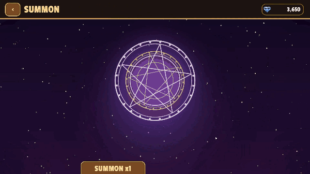
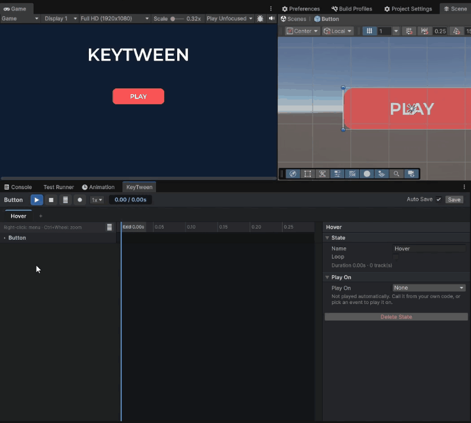
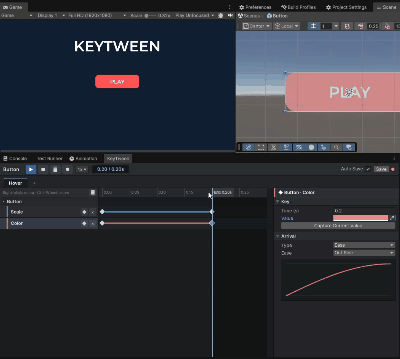
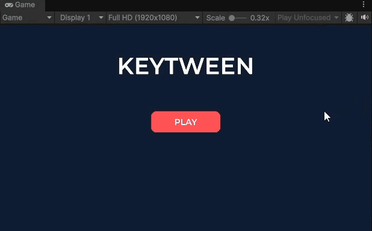
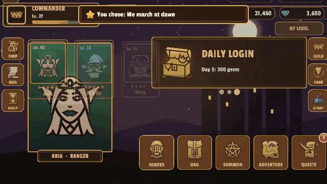
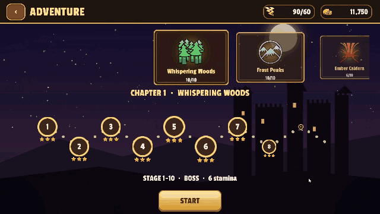

# KeyTween

Keyframe UI animation for Unity uGUI — authored on a timeline, stored in the prefab, played by name.

[](https://unity.com/releases/editor/archive)
[](https://github.com/UnialGames/KeyTween/releases)
[](LICENSE)

[한국어 README](README_KO.md)



## Overview

KeyTween lets you build UI animation the way you build an Animator clip — keys on a timeline — but the animation lives **inside the prefab** as named states (`Hover`, `Open`, `Close` …). There are no clip or controller assets: a track points straight at a component in the prefab. You preview it without entering Play mode, pick when it plays (pointer enter, click, enable …) without code, and when code is needed it plays a state by name and `await`s it.

- **Made in the editor, not in code.** Timeline window, Add Track picker, key inspector, recording, live preview in Edit/Prefab/Play mode.
- **One line from code.** `await anim.PlayAsync("Open")` — Unity `Awaitable`, with a clear rule for how an unfinished play ends.
- **Prefab-native.** States travel with the prefab; a parent prefab can call a nested prefab's state and override its tracks only for itself.
- **Tween-level performance.** No cost when idle, zero GC while playing, ease tracks evaluated with Burst.

Videos: [RPG Sample](https://youtu.be/79Aw-O2kEgA) · [Button hover in the editor](https://youtu.be/13JJNE4_FwI) · [Overriding a button inside a popup](https://youtu.be/rXO_kNexiGc)

## Table of Contents

- [Installation](#installation)
- [Getting Started](#getting-started)
- [Playing and Awaiting](#playing-and-awaiting)
- [When States Overlap](#when-states-overlap)
- [Changing End Values at Runtime](#changing-end-values-at-runtime)
- [Animation Events](#animation-events)
- [Playing Without Code (Play On)](#playing-without-code-play-on)
- [Nested Prefabs: Child Calls and Overrides](#nested-prefabs-child-calls-and-overrides)
- [Sampling, Reading and Writing Values](#sampling-reading-and-writing-values)
- [Scroll List](#scroll-list)
- [Screen Transitions](#screen-transitions)
- [Integrations (UniTask, R3, UIEffect)](#integrations-unitask-r3-uieffect)
- [Samples](#samples)
- [Performance](#performance)
- [Documentation](#documentation)
- [License](#license)

## Installation

**Requirements:** Unity 6000.0 or later. These Unity packages are installed with it: `com.unity.ugui` 2.0.0 (includes TextMeshPro), `com.unity.mathematics` 1.3.2, `com.unity.burst` 1.8.25.

Open **Window > Package Manager**, click **+ > Add package from git URL…** and enter:

```
https://github.com/UnialGames/KeyTween.git#v0.1.0
```

Or add it to `Packages/manifest.json`:

```json
{
  "dependencies": {
    "com.unialgames.keytween": "https://github.com/UnialGames/KeyTween.git#v0.1.0"
  }
}
```

`#upm` instead of `#v0.1.0` follows the latest release. **Samples:** select KeyTween in the Package Manager and import them from the **Samples** tab (see [Samples](#samples)).

## Getting Started

### 1. A hover effect, in the editor

The button grows to 1.1× and gets lighter when the pointer enters, and returns when it leaves. No code. (Full video: [Button Hover Editor](https://youtu.be/13JJNE4_FwI))

1. Open the button prefab and **Window > KeyTween Editor**.
2. Click **Add KeyTween to 'Button'** (or add the `KeyTween` component yourself).
3. Add a state with **+** in the state tabs and name it `Hover` in the state inspector.
4. Right-click an empty part of the timeline → **Add Track…** → pick **Scale** under `RectTransform` and **Color** under `Image` → **Add 2**. Each track gets a key at 0 s and an end key (0.2 s).

   

5. Click Scale's end key: Value `1.1`, Ease `OutBack`. Set Color's end key to a lighter color.
6. Drag the ruler or press **▶** to preview — no Play mode needed.

   

7. In the state inspector, set **Play On** to `PointerEnter`.
8. Make `Unhover` the same way: end keys back at `1` and the original color, Play On `PointerExit`.
9. Enter Play mode and move the pointer over the button.

   

### 2. Playing it from code

```csharp
using System;
using KeyTweening;
using UnityEngine;

public class Popup : MonoBehaviour
{
    [SerializeField] KeyTween anim;

    public async Awaitable Open() => await anim.PlayAsync("Open");

    public async Awaitable Close()
    {
        try { await anim.PlayAsync("Close", cancellationToken: destroyCancellationToken); }
        catch (OperationCanceledException) { return; }   // reopened while closing: keep it
        Destroy(gameObject);
    }
}
```

The animation itself (time, eases, which properties) stays in the editor. Code only says *which state* and *what happens after*.

## Playing and Awaiting

```csharp
anim.Play("Hover");                                // fire and forget; writes the 0 s pose at once
await anim.PlayAsync("Open");                      // completes at the end (or on Complete)
await anim.PlayReversedAsync("Open");              // end → start: events, sounds and child calls run backwards
anim.Complete("Typewriter");                       // jump to the end, raising the remaining events in order
anim.Stop("Idle");                                 // stop where it is (a waiting PlayAsync is canceled)
anim.Sample("Collapse", 0.25f);                    // show the pose at a time, without playing
bool playing = anim.IsPlaying("Open");
float length = anim.Duration("Open");              // including overrides; 0 if there is no such state
```

How a `PlayAsync` ends:

| Case | `PlayAsync` | Remaining events | Remaining sounds |
|---|---|---|---|
| Reaches the end | completes | all raised | all played |
| `Complete` (or another state starts with interrupt `Complete`) | completes | raised in order | not played |
| Another state takes all of its properties | **canceled** | not raised | not played |
| The same state is played again | earlier play **canceled** | not raised | not played |
| Object disabled, `Stop`, token canceled | **canceled** | not raised | not played |

Canceled means `OperationCanceledException`, so "only continue when it really finished" is the default. A looping state's `PlayAsync` ends only by `Complete` or `Stop`. Time is real time (it does not follow `Time.timeScale`). A missing state name logs a warning and completes at once.

**Example: a dialogue box.** Change the text and play the same typewriter state; skipping is `Complete`.

```csharp
dialogue.text = nextLine;
var typing = anim.PlayAsync("Typewriter");
// skip button: anim.Complete("Typewriter");
await typing;
```

## When States Overlap

Several states can play at once. A new state takes over **only the properties it animates**; the rest keep playing (press while hovering). The interrupt decides what happens to what it takes over:

| `KeyTweenInterrupt` | Effect |
|---|---|
| `Cancel` (default) | Takes the overlapping properties where they are. A state left with no properties stops. Tracks that start from the current value continue from there. |
| `Complete` | Snaps the overlapping states to their end values first. |

```csharp
anim.Play("Close", KeyTweenInterrupt.Complete);    // finish Open first, then close from its end pose
```

Play On triggers have the same setting in the state inspector.

## Changing End Values at Runtime

For values known only at runtime (gold, power), make the motion in the editor and pass only the end value. It replaces the track's last key from the next play on; the saved asset is unchanged.

```csharp
// "Count" state on the gold label: a Number (Count) track, 0.6 s OutQuad, made in the editor
counter.SetEndValue("Count", goldLabel, KeyTweenProperty.TextNumber, gold);
counter.Play("Count");
```

`SetEndValue(state, target, property, Vector4)` and a `float` overload (x only). It is read like a key value (Relative To Rest and Size Relative apply).

## Animation Events

Put events on an event track in the editor; receive them in code. An event can carry data: a struct marked `[KeyTweenEvent]` appears in the editor's event type list and its public fields are saved.

```csharp
[KeyTweenEvent("Popup Sound")]
public struct PopupSoundEvent { public string clip; public float volume; }

anim.EventRaised += (in KeyTweenEventInfo e) => Debug.Log($"{e.State}:{e.Name} at {e.Time}");

using var sub = anim.AddListener<PopupSoundEvent>((in KeyTweenEventInfo e, in PopupSoundEvent data) =>
    Debug.Log($"play {data.clip} at {data.volume}"));

KeyTweenEventInfo shown = await anim.WaitEventAsync("Shown");   // the next "Shown" from any state
```

`KeyTweenEventInfo` (passed with `in`): `Animation`, `State`, `Name`, `Time`, `TryGetData<T>(out T)`. `Complete` raises skipped events in order; a canceled play raises none. Without code: **Add Component > KeyTween > Event Listener** maps event names to UnityEvents.

**Sounds** have their own track (a clip and a volume at a time). They play through `KeyTween.audioSource` if set, otherwise one shared hidden 2D source.

## Playing Without Code (Play On)

In the state inspector, **Play On** picks when a state plays; the editor adds a `KeyTweenTrigger` for it.

| Play On | Plays when |
|---|---|
| `None` | only from code |
| `OnEnable` / `Start` | the component is enabled / once after the first enable |
| `PointerEnter` / `PointerExit` / `PointerDown` / `PointerUp` / `Click` | pointer events |
| `Select` / `Deselect` | selection events |
| `ToggleOn` / `ToggleOff` | the `Toggle` on the same object changes |

A Selectable whose `interactable` is off ignores input triggers. From a UnityEvent such as Button `OnClick`, wire `KeyTween.PlayState(string)` (or `PlayStateReversed`).

## Nested Prefabs: Child Calls and Overrides

A shared prefab (a button) placed inside another prefab (a popup):

- **Child call** — the popup's `Open` state calls the button's `Hover` at 0.25 s (timeline right-click → **Add Child Call ▸ child ▸ state**). It shows as a bar on the parent's timeline, and the parent's length includes it.
- **Override** — the called state's tracks appear dimmed under the call. Click one and **only that track** is overridden in the popup; the button prefab is unchanged, and the tracks you did not touch keep following it. With several levels (screen > popup > button), the outermost wins, like Unity's nested prefab rule.

Video: [Overriding a button inside a popup](https://youtu.be/rXO_kNexiGc) · Details: [Guide §12](Docs/Guide.md#12-자식-호출과-오버라이드-중첩-prefab)

## Sampling, Reading and Writing Values

```csharp
// Drive a state by something other than time, e.g. how far a header is scrolled (0..1)
anim.Sample("Collapse", progress * anim.Duration("Collapse"));

// Read and write one property the way tracks do (one-value properties use x)
Vector4 color = KeyTween.Read(image, KeyTweenProperty.GraphicColor);
KeyTween.Write(label, KeyTweenProperty.TextNumber, new Vector4(1234, 0, 0, 0));   // "1,234"
```

## Scroll List

`KeyTweenScrollList` is a **virtualized** list on a `ScrollRect`: only visible items exist and are reused while scrolling. Every layout is a setting of this one component, and every animation is a state of the item's `KeyTween` (entry with stagger, appear, or a scrub state driven by the item's position in the viewport).

```csharp
// Bind like UI Toolkit's ListView; ItemView is any component on the item prefab
list.SetData(items, (ItemView view, Item item, int index) => view.Set(item));
list.SetCount(100, (ItemView view, int index) => view.Set(items[index]),
                   (ItemView view, int index) => view.Clear());          // unbind is optional

list.prefabOf = i => items[i].isHeader ? 1 : 0;   // several item prefabs (set before SetCount)
list.SetCount(items.Count);                        // count only: keeps the scroll position, new items appear
list.ScrollTo(20, KeyTweenScrollList.Alignment.Center, 0.3f);
list.CurrentIndexChanged += i => indicator.text = $"{i + 1} / {list.Count}";

list.RemoveItem(5);                                // after removing it from your data: the rest slide up
await list.ResizeItem(3, 0f);                      // accordion: animate one item's size, then remove it
```

Layouts: vertical, horizontal, grid, masonry, plus loop, snap (nearest / one per swipe), auto scroll, stick to end and sticky headers — enough for carousels, pages, banners, wheel pickers, chat, accordions, tabs, a collapsing header and pull to refresh. Helpers: `KeyTweenPageIndicator`, `KeyTweenScrollScrub`, `KeyTweenPullToRefresh`. The **UI Components** sample has 18 examples. Details: [ScrollList](Docs/ScrollList.md)

## Screen Transitions

Page, Modal and Sheet containers (the role of UnityScreenNavigator) inside the package. A transition is a state of the screen prefab's `KeyTween` by name; a missing one uses the built-in default. Everything is an `Awaitable`.

```csharp
await pages.Push(loadingPage, stack: false);   // removed and destroyed when the next page comes in
await pages.Push(homePage);
await pages.Pop();

await modals.Push(confirmPopup);               // adds a backdrop; states "Enter" / "Exit"
await modals.Pop();

int shop = sheets.Register(shopTabPrefab);     // tabs
await sheets.Show(shop);
```

| Container | Screen states | Default (0.3 s) |
|---|---|---|
| `KeyTweenPageContainer` | `PushEnter`, `PushExit`, `PopEnter`, `PopExit` | slide by one screen width |
| `KeyTweenModalContainer` | `Enter`, `Exit` (and the backdrop's) | scale 0.3 → 1 with fade |
| `KeyTweenSheetContainer` | `Enter`, `Exit`, `EnterBackward`, `ExitBackward` | fade |

Input is blocked while any container is in transition. A component on the screen can implement `IKeyTweenScreenLifecycle` (every method is optional):

```csharp
public sealed class HomePage : MonoBehaviour, IKeyTweenScreenLifecycle
{
    public async Awaitable WillEnter(KeyTweenTransition t) => await LoadAsync();   // awaited before the animation
    public void DidEnter(KeyTweenTransition t) { }
    public Awaitable WillExit(KeyTweenTransition t) => KeyTweenScreen.Completed();
    public void DidExit(KeyTweenTransition t) { }
    Awaitable LoadAsync() => KeyTweenScreen.Completed();
}
```

**Shared element transition** — a list portrait flies into the detail page's portrait. The motion is a Position·Size track made in the editor; only the partner's on-screen rect is filled in at runtime:

```csharp
public Awaitable WillEnter(KeyTweenTransition t)
{
    KeyTweenSharedElement.SetPartnerKeys(GetComponent<KeyTween>(), "PushEnter", portrait, card, atStart: true);
    return KeyTweenScreen.Completed();
}
```

Details: [Screens](Docs/Screens.md)

## Integrations (UniTask, R3, UIEffect)

The package needs no third-party library. When one of these is installed, its integration compiles automatically (asmdef version defines); nothing to configure.

```csharp
// UniTask (com.cysharp.unitask 2.0+)
await UniTask.WhenAll(popup.PlayUniTaskAsync("Open"), dim.PlayUniTaskAsync("Show"));
bool canceled = await popup.PlayUniTaskAsync("Close").SuppressCancellationThrow();
KeyTweenEventInfo info = await anim.WaitEventUniTaskAsync("Shown");

// R3 (com.cysharp.r3 1.0+)
open.OnClickAsObservable().ThrottleFirst(TimeSpan.FromSeconds(0.5))
    .SelectMany(_ => popup.PlayAsObservable("Open"))
    .Subscribe(_ => Debug.Log("opened")).AddTo(this);
popup.EventAsObservable("Shown").Subscribe(e => Debug.Log(e.Time)).AddTo(this);
```

| Library | Adds |
|---|---|
| UniTask | `PlayUniTaskAsync`, `PlayReversedUniTaskAsync`, `WaitEventUniTaskAsync` (same completion rules as `PlayAsync`) |
| R3 | `PlayAsObservable` (plays on subscribe, emits once at the end, stops on dispose), `EventsAsObservable`, `EventAsObservable` |
| UIEffect (`com.coffee.ui-effect` 5.0+) | 14 tracks: tone, color, sampling, transition (dissolve …), edge shine, gradation, detail |

Details: [Integrations](Docs/Integrations.md)

## Samples

| Sample | Where | What | Needs |
|---|---|---|---|
| **RPG Sample** | Package Manager › Samples | A whole mobile RPG UI: title, lobby, heroes and upgrade, bag, summon, adventure, battle, quests, shop, mail, guild chat, ranking, story, settings. Every motion is a prefab state; scripts only open screens and fill data. Scene `Scenes/RPG.unity` | Input System |
| **UI Components** | Package Manager › Samples | Buttons, hover effects, toggles, a popup, text effects and 18 scroll list examples, one scene each | Input System |
| UniTask | this repository, `Assets/KeyTween/Samples/UniTask` | `WhenAll`, `SuppressCancellationThrow`, `Timeout` + `Complete`, waiting for an event | UniTask |
| R3 | this repository, `Assets/KeyTween/Samples/R3` | `ThrottleFirst` against double taps, `Switch` on close, an event log | R3 |

| Heroes → detail (shared element) → upgrade | Adventure → formation → battle → victory |
|---|---|
|  |  |
| **Ranking: a long list** | **Mail and daily rewards** |
|  |  |

## Performance

Windows player, IL2CPP release, 2,000 objects. In parentheses: time above setting the same values directly from a script — the cost of the method itself.

| | KeyTween | DOTween Pro | LitMotion | Animator | AnimationUI |
|---|---:|---:|---:|---:|---:|
| Looping pulse (ms) | 7.69 (+0.38) | 7.71 (+0.40) | 7.66 (+0.34) | 10.16 (+2.85) | 9.31 (+2.00) |
| List entry (ms) | 1.70 (+0.04) | 1.59 (−0.06) | 1.53 (−0.13) | 5.23 (+3.57) | 2.18 (+0.52) |
| Text wave, 100 objects (ms) | **0.61** | 2.11 | 2.05 | not supported | not supported |

- No GC while playing, on par with code tweens (DOTween Pro, LitMotion) and lighter than Animator and AnimationUI. Text effects are the fastest.
- The weak spot is starting plays: restarting 2,000 at once costs 2.31 ms (LitMotion 1.34 ms).

Method and full tables: [Performance](Docs/Performance.md), [Benchmarks](Docs/Benchmarks.md)

## Documentation

The full documents are in Korean.

| Document | Contents |
|---|---|
| [Guide](Docs/Guide.md) | The editor: window, states, tracks and keys, preview, saving, recording, nested prefab overrides |
| [API](Docs/API.md) | Code: playing, awaiting, events, runtime values |
| [ScrollList](Docs/ScrollList.md) | The scroll list and its helper components |
| [Screens](Docs/Screens.md) | Screen containers, lifecycle, shared elements |
| [Integrations](Docs/Integrations.md) | UniTask, R3, UIEffect |
| [Comparison](Docs/Comparison.md) | Authoring compared with other tools |
| [Performance](Docs/Performance.md) · [Benchmarks](Docs/Benchmarks.md) | How the numbers above were measured, full result tables |

## License

[MIT](LICENSE). The RPG sample's icons are from [game-icons.net](https://game-icons.net) (CC BY 3.0, authors in `Samples/RPG/Art/CREDITS.md`); its font is Passion One (SIL OFL 1.1).
